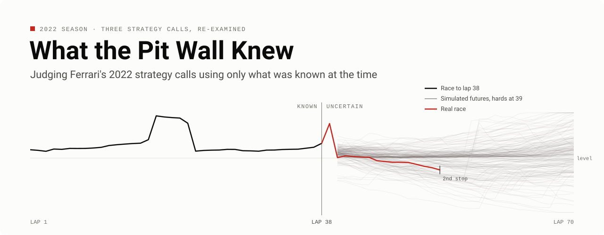
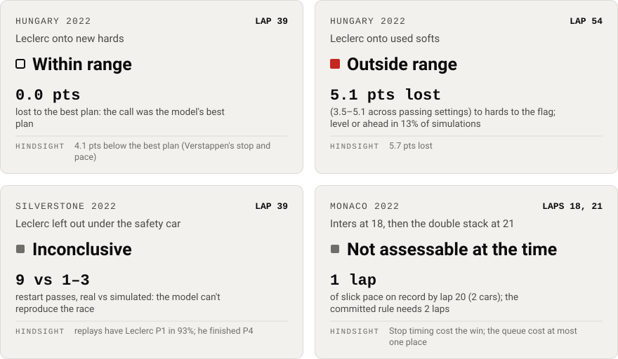
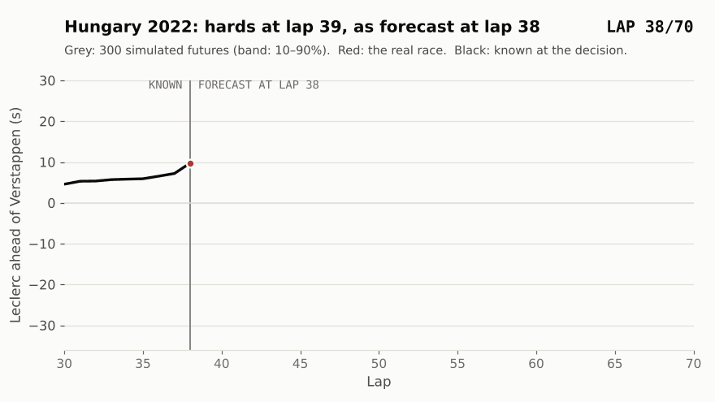
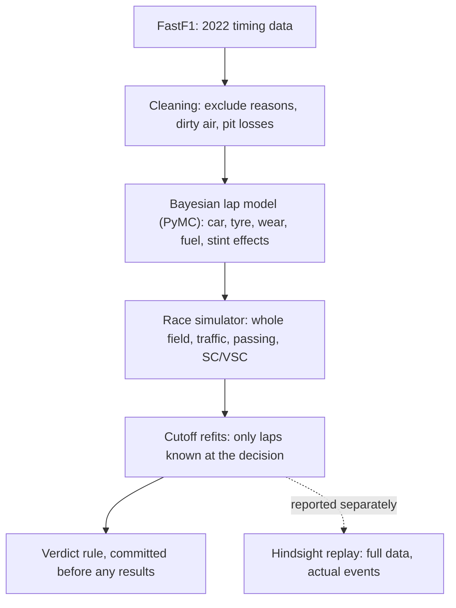
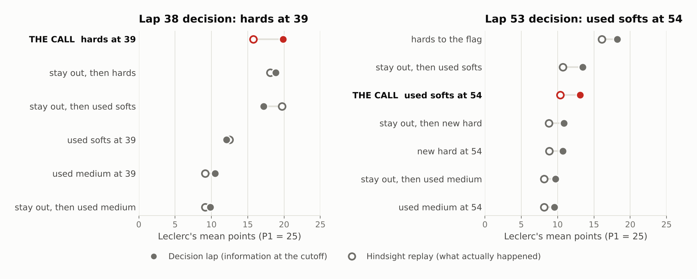
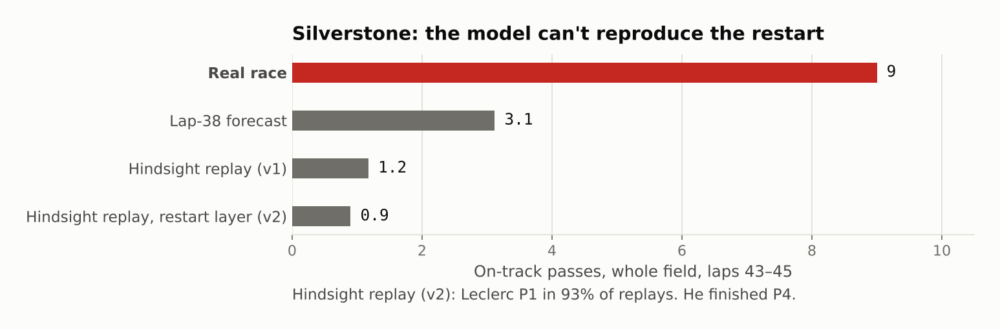
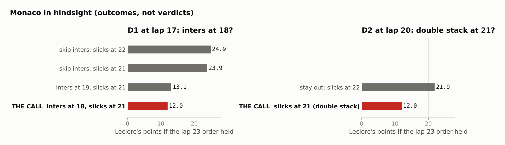
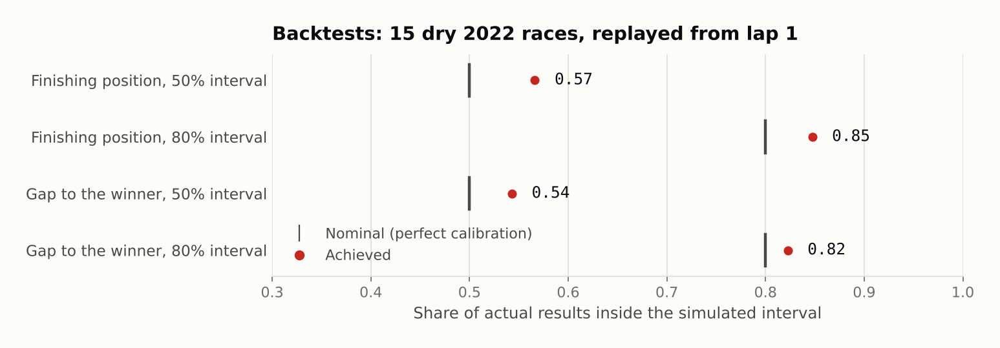

<picture>
  <source media="(prefers-color-scheme: dark)" srcset="assets/readme/banner_dark.svg">
  
</picture>

<p>
  
  <a href="https://github.com/tinySage/what-the-pit-wall-knew/actions/workflows/tests.yml"></a>
  <a href="LICENSE"></a>
  <a href="https://github.com/theOehrly/Fast-F1"></a>
</p>

## The question

In 2022 Ferrari made three strategy calls that were widely criticised: Leclerc onto hards in Hungary, Leclerc left out under the late safety car at Silverstone, and the double stack at Monaco.
Criticism after a race uses information the pit wall did not have when it decided.
This project refits a lap-time model and a race simulator on only the data available at each decision lap, and asks whether each call was within the range of good options.

## Verdicts

<picture>
  <source media="(prefers-color-scheme: dark)" srcset="assets/readme/verdicts_dark.svg">
  
</picture>

The large label is the verdict with information at the decision lap. Hindsight outcomes are reported separately and never change it.

| Race | Lap | Call | Verdict at the decision lap | Key number | Hindsight |
|---|---|---|---|---|---|
| Hungary 2022 | 39 | Leclerc onto new hards | **Within range** | 0.0 points lost: the call was the model's best plan | 4.1 points below the best plan (Verstappen's stop and pace) |
| Hungary 2022 | 54 | Leclerc onto used softs | **Outside range** | 5.1 points lost to hards to the flag; level or ahead in 13% of simulations | 5.7 points lost |
| Silverstone 2022 | 39 | Leclerc left out under the safety car | **Inconclusive** | 9 restart passes in the real race against 1–3 simulated: the model cannot reproduce the race | Replays have Leclerc P1 in 93%; he finished P4 |
| Monaco 2022 | 18 and 21 | Inters at 18, then the double stack at 21 | **Not assessable at the time** | 1 lap of slick pace identified by lap 20 (2 cars); the rule needs 2 | Stop timing cost the win; the queue cost at most one place |

Bands, fixed before any case-study simulation: **within range** if the best plan beats the call by at most 1 point on average; **outside range** if it beats it by more than 3 points and the call finishes level or ahead in under 25% of simulations; **marginal** otherwise.

## Hungary, as the pit wall saw it at lap 38

<picture>
  <source media="(prefers-color-scheme: dark) and (prefers-reduced-motion: reduce)" srcset="assets/readme/hero_dark.png">
  <source media="(prefers-reduced-motion: reduce)" srcset="assets/readme/hero_light.png">
  <source media="(prefers-color-scheme: dark)" srcset="assets/readme/hero_dark.gif">
  
</picture>

The simulated gap starts at lap 40, once both cars have stopped. From there the real race ran inside the forecast's spread, in its unfavourable tail, until lap 54, when Leclerc stopped again for used softs. That second stop is a separate decision with its own verdict (outside range).

The animation's 300 futures come from a rerun of the lap-38 cutoff fit (same data and sampler settings, 0 divergences; Ferrari's hard wear 0.027 s/lap in both runs). The verdict numbers come from the committed original run. The data behind it is [`data/figures/hungary_fan.csv`](data/figures/hungary_fan.csv). Still images: [dark](assets/readme/hero_dark.png), [light](assets/readme/hero_light.png).

## How it works



1. **Data and cleaning.** Every 2022 race lap from FastF1, with one exclude reason per unusable lap (in and out laps, SC/VSC, wet compounds, outliers) and a per-circuit green-flag pit loss.
2. **Lap model.** A hierarchical Bayesian model of clean lap time: car pace, compound offsets, linear tyre wear per compound and race, team-specific tyre terms, fuel and track trend, and stint effects. Fitted with PyMC and nutpie; [docs/model.md](docs/model.md).
3. **Race simulator.** Every car lap by lap, 1,000+ simulations per plan with common random numbers: traffic and passing calibrated on 2022, SC/VSC drawn at 2022 rates, tyre sets reconstructed from practice and qualifying, a search over every legal strategy; [docs/simulator.md](docs/simulator.md).
4. **Cutoff refits.** For each decision the model is refitted on laps known at that lap plus that weekend's practice long runs, and the passing and SC parameters come from earlier races only.
5. **Verdict and hindsight.** The best plan is chosen on 1,000 simulations and the loss measured on a fresh 2,000. The hindsight replay (full data, actual safety cars, rivals' actual plans) is reported next to it, not mixed in; [docs/case_studies.md](docs/case_studies.md).

## What keeps it honest

- **No future data in a verdict.** Each cutoff refit recomputes the cleaning from the laps known at the decision (outlier thresholds, pit stops), labels no stint of the decision race as final, and takes passing and safety-car parameters from earlier races. A test changes every later lap and checks that nothing moves.
- **The verdict rule was committed before any results.** Metric, bands, robustness checks and the selection/measurement split are in [docs/case_studies.md](docs/case_studies.md), committed before the first case-study simulation, so the rule could not be tuned to the answer. Later method changes are labelled post hoc.
- **A verdict replicated from an independent refit.** Hungary's lap-38 cutoff fit was refitted from scratch and the committed procedure rerun unchanged in a fresh clone. The lap-39 verdict reproduced under all 8 checks: within range, with the call as the best plan (19.70 mean points against 19.87 committed). The hindsight replay was identical. Details: [docs/validation.md](docs/validation.md#independent-replication-of-a-verdict-phase-7).
- **Decision and hindsight are kept apart.** A call can be right with what was known and still lose. Hungary's lap-39 call was the model's best plan at lap 38 and cost about 4 points in hindsight, because Verstappen's stop and pace were better than the pit wall could know.
- **Silverstone: my own check rejected a convenient result.** Two model versions said staying out was within range. But with the actual safety car and the rivals' actual plans, the replay had Leclerc winning 93–95% of the time; he finished P4. A model that cannot reproduce the race given what happened cannot judge the call, so the verdict is inconclusive rather than "within range".

## Case studies

<details>
<summary><b>Hungary 2022</b>: hards at lap 39 within range; used softs at lap 54 outside range</summary>

<br>

<picture>
  <source media="(prefers-color-scheme: dark)" srcset="assets/readme/fig_hungary_dark.png">
  
</picture>

- **Lap 39, hards:** the model's best plan at lap 38 (19.9 points, P1 in 47% of simulations), and under all 7 robustness checks. It stops being best only if Ferrari's hards were 0.5 s/lap slower than expected; the lap-53 data put the deficit at +0.08 s/lap.
- **Lap 54, used softs:** hards to the flag was better by 5.1 points with lap-53 information. Leclerc was P2 with Russell 0.3 s behind; a 23 s stop dropped him behind Russell, Sainz and usually Hamilton at a circuit where passing is hard.
- **The points were lost at lap 54.** The ~4 points the lap-39 call cost in hindsight came from what the pit wall could not know: Verstappen's quicker stop phase and his pace on new mediums.

Full write-up: [docs/case_studies.md, Hungary](docs/case_studies.md#hungary-2022-leclerc-onto-hards).

</details>

<details>
<summary><b>Silverstone 2022</b>: inconclusive, because the model cannot reproduce the restart</summary>

<br>

<picture>
  <source media="(prefers-color-scheme: dark)" srcset="assets/readme/fig_silverstone_dark.png">
  
</picture>

- **Given the model, staying out was its best plan** (23.3 points against 21.4 for new softs), within range under all 13 checks, and Ferrari's split strategy was the best joint option for the team.
- **But the hindsight replay fails:** with the actual safety car and rivals' plans, Leclerc wins 93–95% of replays. The miss sits in the three laps after the restart (+0.87 s/lap against Sainz, 9 passes against 1–3 simulated).
- **A restart layer estimated from 2022 did not fix it.** Earlier restarts show no extra loss for old tyres and fewer passes per close pair, so no verdict is given.

Full write-up: [docs/case_studies.md, Silverstone](docs/case_studies.md#silverstone-2022-leclerc-left-out-under-the-late-safety-car).

</details>

<details>
<summary><b>Monaco 2022</b>: not assessable at the time; the stop timing cost the win in hindsight</summary>

<br>

<picture>
  <source media="(prefers-color-scheme: dark)" srcset="assets/readme/fig_monaco_dark.png">
  
</picture>

- **Not assessable at either decision.** The lap model is dry-only, so Monaco uses track-position accounting. At laps 17 and 20 the public timing data had no slick pace identified by 2 or more cars on 2 or more laps.
- **In hindsight** (outcomes, not verdicts), skipping inters or staying out to lap 22 would likely have kept Leclerc P1: 22–25 points against the 12 he scored.
- **The double stack's queue** cost 2.45 s and at most one place (P3 to P4), inside the lap-time noise.

Full write-up: [docs/case_studies.md, Monaco](docs/case_studies.md#monaco-2022-the-crossover-and-the-double-stack).

</details>

## The evidence

**Lap-time model against baselines** (held-out final stints of the odd-numbered 2022 rounds, 2,477 laps; [docs/model.md](docs/model.md)):

| Model | Mean absolute error (s) | RMSE (s) |
|---|---:|---:|
| **Bayesian hierarchical model** | **0.60** | **0.84** |
| Per-race linear regression | 0.87 | 1.13 |
| XGBoost | 1.01 | 1.27 |

**Simulator against the real finishing order** (15 dry 2022 races replayed from lap 1 with the actual stops; [docs/validation.md](docs/validation.md)):

| | Rank correlation with the real order | Mean position error (places) |
|---|---:|---:|
| **Simulator** | **0.96** | **0.96** |
| Order after lap 1 | 0.76 | 2.33 |

**Calibration.** Of the actual results, 57% fell inside the simulated 50% interval and 85% inside the 80% interval (finishing positions); 54% and 82% for gaps to the winner. Intervals are slightly wide, so verdicts lean conservative. Simulated on-track passes on the held-out rounds: 311 against 318 real.

<picture>
  <source media="(prefers-color-scheme: dark)" srcset="assets/readme/fig_calibration_dark.png">
  
</picture>

## Limitations

> [!WARNING]
> - **Ferrari knew more than this model.** Its own fuel loads, engine modes, tyre temperatures and driver feedback are not in the public timing data. Practice runs inform tyre wear here, not pace level.
> - **Tyre wear is linear** in tyre age. A tyre cliff, or a temperature-driven problem like Hungary's cool final third, would not be seen.
> - **Restart laps are normal green laps** in the simulator, which is why Silverstone is inconclusive.
> - **No wet or crossover pace model,** which is why Monaco is not assessable.
> - **Pass difficulty for Hungary comes from the 2021 race.** 2022 cars followed more closely, so this likely overstates it; with average passing the lap-54 verdict is marginal (3.6 points), though the switch is still the worse option.
> - **Verdicts concern Leclerc's points only,** not the team result. Lap 1, time penalties, blue flags and damage are not modelled. One season of data.

## Quick start

Redraw every figure in the docs, the notebooks and this page from the committed tables in [`data/figures/`](data/figures/README.md): no fits, simulations or downloads, about a minute. Needs [uv](https://docs.astral.sh/uv/).

```bash
git clone https://github.com/tinySage/what-the-pit-wall-knew.git
```

```bash
cd what-the-pit-wall-knew && uv sync
```

```bash
uv run pitwall figures
```

```bash
uv run pytest
```

`uv run pytest` runs the fast tests (about 15 seconds). `uv run pytest -m ""` adds the Bayesian fits and the FastF1 download test (about 3 minutes).

## Full reproduction

From raw FastF1 downloads to every result, on a 4-core machine. "Measured" times are from a run of each step in a fresh clone during Phase 7; "logged" ones add up the fit times recorded in the docs.

| Step | Command | Time | Basis |
|---|---|---|---|
| Download 2022 races, practice long runs, 2021 pass events | `uv run pitwall data` | 4 min of downloads; from an empty cache, rerun after an hour (see below) | measured |
| Clean laps and estimate pit losses | `uv run pitwall clean` | 33 s | measured |
| Fit the full model and the two held-out splits | `uv run pitwall fit all` | 1 h 45 min (39 + 39 + 28 min) | measured (splits), logged (full) |
| Simulator parameters, calibration, backtests | `uv run pitwall backtest` | 98 s | measured |
| Dress rehearsals (Spain, Canada) | `uv run pitwall backtest rehearsal` | about 2 h 15 min (four cutoff fits) | logged |
| Hungary: two cutoff fits, verdicts, sensitivities | `uv run pitwall case-study hungary` | about 2 h 15 min (fits 38 + 45 min; 9.4 min per decision) | measured (lap 38), logged (lap 53) |
| Silverstone: cutoff fit, v1, restart layer, v2 | `uv run pitwall case-study silverstone` | about 1 h 30 min (fit 27 min) | logged fit; checks estimated from Hungary's |
| Monaco: reconstruction and accounting | `uv run pitwall case-study monaco` | 29 min | measured |
| Rebuild the figure tables and redraw every figure | `uv run pitwall figures --export` | 45 s | measured |
| Execute the notebooks top to bottom | `uv run pitwall figures --notebooks` | 4 min | measured |

FastF1 allows 500 API calls an hour. From an empty cache, `pitwall data` stops with a message when it reaches the limit, without saving partial tables. Rerun it after an hour; everything downloaded so far is cached.

The fresh-clone runs reproduced the committed backtests (identical up to floating-point rounding), the 2022 race data and Monaco's results exactly.

Cutoff fits are saved in `models/` (gitignored) and reused; a case study refits them only if they are missing. `uv run pitwall --help` lists every command.

## Repository map

```
src/f1strat/         the package: data, cleaning, lap model, simulator, case studies
  cli.py             the pitwall command line
  deg_model.py       Bayesian lap-time model (PyMC), baselines, XGBoost
  simulator.py       race state, strategy search, whole-field simulation
  case_study.py      verdict rule, Hungary and Silverstone
  monaco.py          Monaco track-position accounting
docs/                model, simulator, validation and case-study write-ups
data/processed/      cleaned 2022 parquet per race (committed)
data/figures/        the exact data each figure plots (committed)
models/              thinned posteriors (committed)
reports/figures/     results (JSON, CSV) and figures
notebooks/           exploration: EDA, lap model, simulator demo
assets/readme/       images on this page
tests/               pytest
```

## Acknowledgements

- Timing data from [FastF1](https://github.com/theOehrly/Fast-F1). Thanks to its maintainers; this project would not exist without it.
- Built with [Claude Code](https://claude.com/claude-code).
- This is an unofficial, independent analysis. It is not associated with Formula 1, Ferrari or any team.

## Author and citation

Muktanan Mohapatra. Released under the [MIT licence](LICENSE).

To cite this work, use [`CITATION.cff`](CITATION.cff) (GitHub's "Cite this repository" button), or:

> Mohapatra, M. (2026). *What the Pit Wall Knew: judging Ferrari's 2022 strategy calls using only what was known at the time* (Version 1.0.0) [Computer software]. https://github.com/tinySage/what-the-pit-wall-knew
