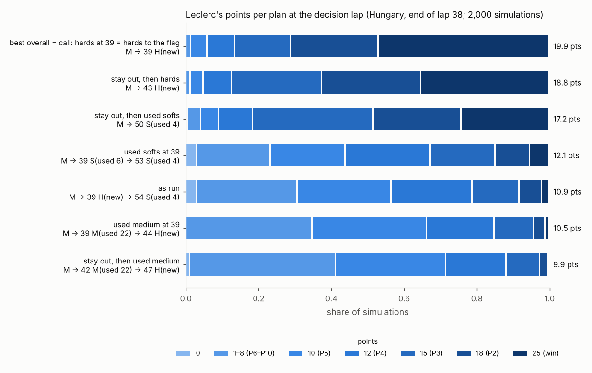
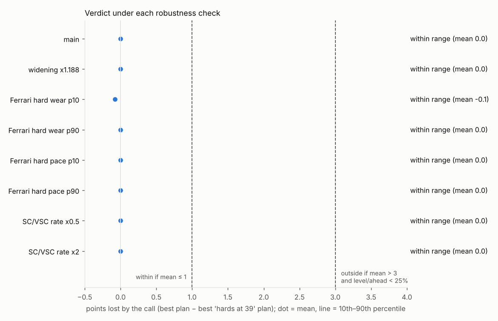
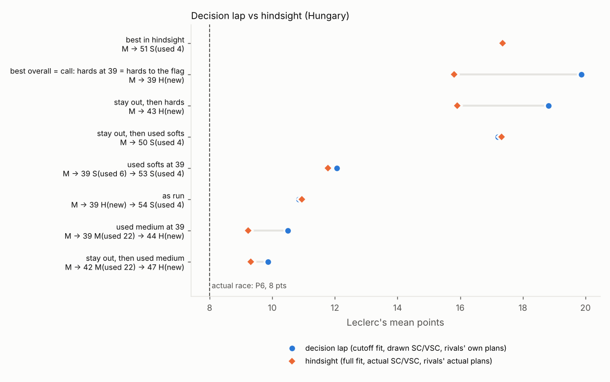
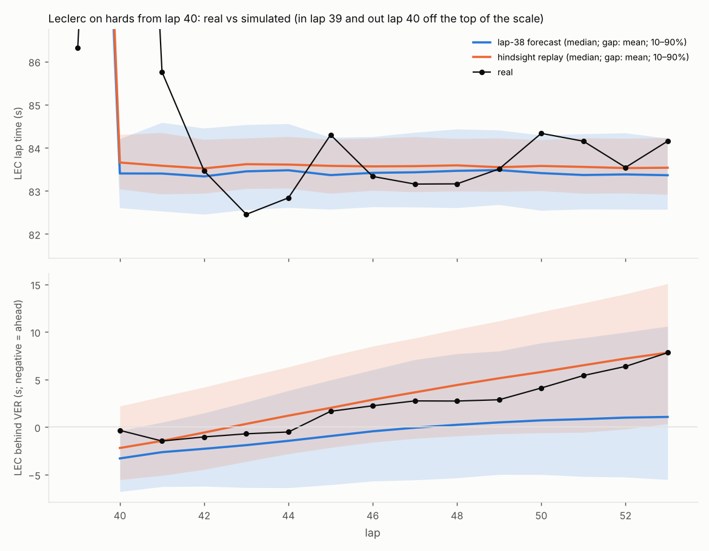
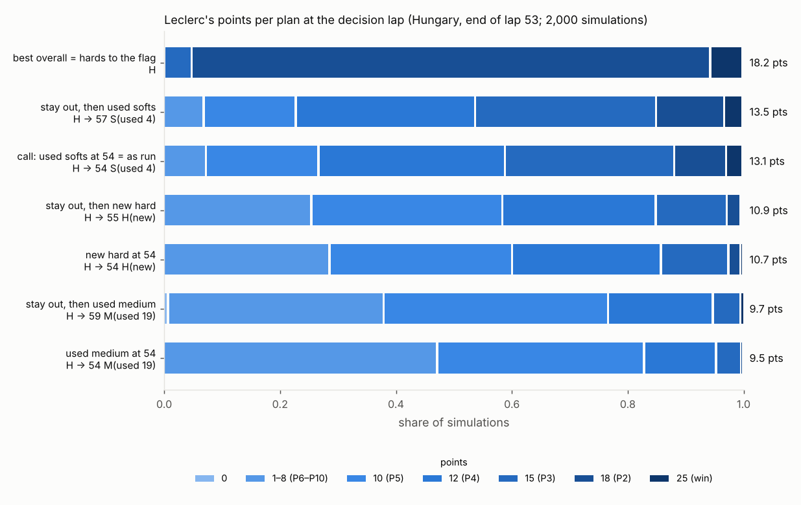
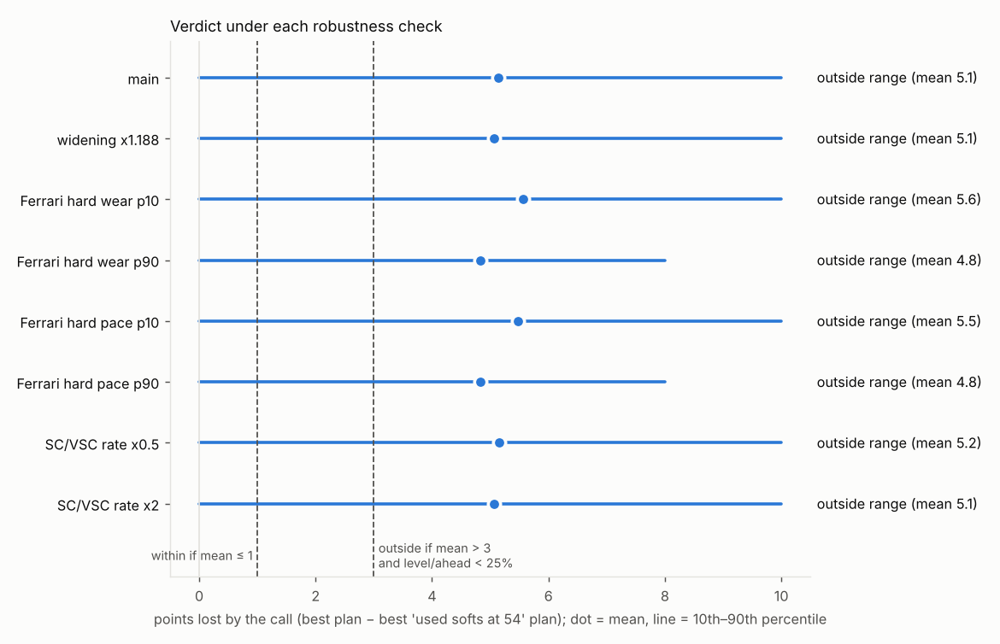
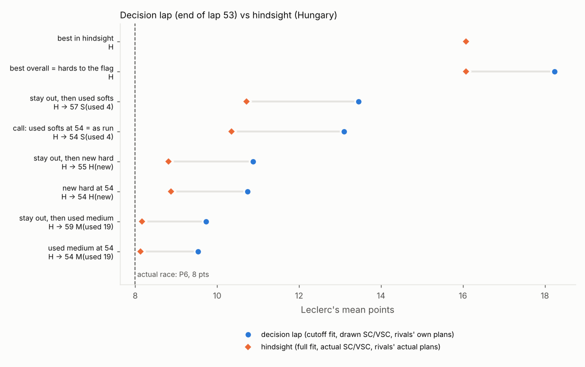

# Case studies (Phase 6)

Question for each call: **using only what the Ferrari pit wall knew at the
decision lap, was the call within the range of good options?**

This file fixes the verdict rule **before any case-study simulation is run**
(committed first, so the rule cannot be tuned to the answer). Results are
added below the rule, case by case.

## Verdict rule (all case studies)

### Metric

- **Leclerc's championship points** from the finishing position, 2022 table:
  25, 18, 15, 12, 10, 8, 6, 4, 2, 1 for P1–P10, 0 below. No fastest-lap
  point.
- **Judge the call, not later decisions.** The call is the decision made at
  the cutoff (e.g. "hards at lap 39"). Later stops in the actual race were
  separate decisions made with more information.
  - **Primary comparison:** the **best plan overall** against the **best plan
    that starts with the call** (the call family), both chosen on the
    selection set.
  - **Loss** = best-overall points − best-call-family points, in the same
    simulation.
- Plans are paired by common random numbers, so every plan meets identical
  luck (lap noise, stint and pit-loss draws, SC/VSC timing, pass coin-flips,
  rival plan picks).
- **Also reported, not used for the band:** the loss of the actual plan as
  run, and of the call held to the flag where that applies.

### Choosing the best plan without flattering it

1. **Selection set:** 1,000 simulations. Every candidate plan is simulated.
   The **best plan overall** and the **best plan in each named family**
   (including the call family) are the ones with the highest mean points.
2. **Measurement set:** a **fresh** 2,000 simulations with a different seed:
   new posterior draws, new field draws, and rival plan options rebuilt from
   their own searches on that field.
   - The loss distribution is measured here, for the plans chosen in step 1.
   - Re-using the selection set would let the best plan's own good luck count
     as an advantage (the winner's curse). The fresh set removes that bias.

### Bands

On the measurement set:
- **Within range:** mean loss ≤ 1 point.
- **Outside range:** mean loss > 3 points **and** the best call-family plan
  finishes level with or ahead of the best plan overall (its position ≤ the
  best plan's) in **under 25%** of simulations.
- **Marginal:** anything else.

Also reported: the loss distribution (mean, 10th/50th/90th percentiles,
P(loss > 0), P(loss < 0)) and Leclerc's points distribution for every
candidate plan.

### Tyre-age cap (search, every car)

- **No set may run beyond the oldest tyre age the model has clean 2022 data
  for on that compound,** from the data known at the cutoff.
- **Why:** wear is linear in tyre age (Phase 3), which underpredicts very old
  tyres. A plan beyond the data could win for the wrong reason.
- **Applies to:** every stint, including the one on the car, in Leclerc's
  search and in every rival's own search.
- Every plan the cap removes is reported: how many, and the best removed plans
  by single-car expected time.

### Tyre sets

- Sets come from the reconstructed practice/qualifying inventory, minus the
  sets fitted in the race.
- **Sets already used in the race go back into the pool** with their laps:
  refitting a used race set is legal. This applies to every car; the set on
  the car is not double-counted.

### Robustness

The band is recomputed under each of these, with the same selection and
measurement procedure:

| Check | Change |
|---|---|
| Widening | final-stint widening ×1.188 (Phase 6 default: 1.0; `docs/validation.md`) |
| Ferrari hard wear, low | `deg[hard, r] + team_deg[Ferrari, hard]` fixed at its posterior 10th percentile in every draw (both Ferraris) |
| Ferrari hard wear, high | the same at its 90th percentile |
| Ferrari hard pace, low | `team_compound[Ferrari, hard, r]` fixed at its posterior 10th percentile in every draw (both Ferraris); the field's `compound_offset[hard, r]` keeps its draws |
| Ferrari hard pace, high | the same at its 90th percentile |
| SC rate halved | SC and VSC start probabilities per green lap × 0.5 |
| SC rate doubled | SC and VSC start probabilities × 2 |
| Medium availability | both ways, **only if** the inventory reconstruction is uncertain about it |

The verdict is **robust** only if the band is the same under every check.
Otherwise the verdict states which check moves it and in which direction.

### Hindsight replay (separate from the verdict)

The verdict judges the **call**; the hindsight replay shows the **outcome**.
It is reported next to the verdict, never mixed into it:
- full-season fit (the committed thinned full posterior), which includes this
  race's own later laps;
- the actual SC/VSC periods after the decision lap, forced;
- rivals on their **actual** plans; actual retirements;
- Leclerc's candidate plans, as chosen at the decision lap, plus the best plan
  in hindsight among the same candidates.
- **Stint effects in hindsight:** every stint that actually happened uses the
  full fit's estimated stint effect, for every car, instead of a fresh draw.
  - A focal stint that happened (same set fitted on the same lap) keeps its
    effect for the whole stint, including laps beyond the actual stint's end
    in plans that run it longer.
  - Only stints that never happened draw fresh effects.
  - (Added after the first Hungary run, which drew every future stint fresh.)

### Decision-lap inputs (shared by every case study)

Built by the Phase 5 pipeline (`f1strat.rehearsal`; `docs/validation.md`,
Part B/C):
- **Refit** on laps known at the cutoff (`cutoff_inputs`: cleaning
  recomputed from known laps only; no stint of the decision race labelled
  final), **plus the decision race's FP1–FP3 long runs**
  (`docs/model.md`).
  - **0 divergences** required (`rehearsal.clean_fit`), plus the Phase 3
    diagnostics: R-hat < 1.01, ESS ≥ 400.
- **Leakage-free simulator parameters:**
  - passing, SC/VSC rates, SC closing ratio and pass shift from the dry
    rounds before the decision race;
  - the circuit's pass intercept (see "Circuit pass difficulty" below;
    `rehearsal.leakage_free_params`).

### Circuit pass difficulty

**Hungary (committed, kept):** the circuit's intercept was estimated from its
previous running (Hungary 2021), shrunk toward the pooled 2022 intercept of
the rounds before it.

**Silverstone and Monaco (method change, recorded before any simulation for
them):**

```
intercept[circuit] = a_2022(rounds before the decision race)
                   + (c_2021[circuit] − a_2021)
```

- `a_2022` is the pooled 2022 intercept from the dry rounds before the
  decision race.
- `c_2021[circuit]` and `a_2021` come from **one** pass model fitted to every
  dry 2021 race that downloads (`race_events.season_pass_events`,
  `relative_circuit_intercept`). Both use the same stint-line pace proxy,
  slope and shrinkage.
  - A race counts as dry if at least half its laps with a compound are on
    dry compounds.
  - Races that do not download, or are wet, are listed with the results.
- **Why:** the 2022 cars were designed to follow more closely.
  - An absolute 2021 intercept carries 2021's general difficulty of passing
    into 2022. At Hungary, 2021 gave −4.60 against −2.78 pooled for 2022
    (and −2.74 from Hungary 2022's own race, known only in hindsight).
  - Only the circuit's difficulty **relative to its season** is taken from
    2021; the level comes from 2022.
- **Found after the Hungary results**, so Hungary's committed verdicts keep
  the previous-running method. The relative method is reported for Hungary as
  a labelled post-hoc sensitivity.
- **Pit losses** resampled from the decision race's green-flag stops
  completed by the cutoff.
- **Race state** at the cutoff; **tyre sets** as above, with the tyre-age cap.
- **Rivals:** each on its own top-3 single-car plans from the same fit,
  weighted by `exp(−Δmean / 3 s)`. Never their actual later stops.
- **Simulator settings:** widening 1.0, 1,000 thinned posterior draws.

### Stated limits (all case studies)

- **The verdict concerns Leclerc's points only,** not Ferrari's team result
  (e.g. Sainz, or the constructors' points).
- **Ferrari knew more than this model.**
  - Practice long runs inform tyre **wear**, not pace level: each run has a
    free offset for its unknown fuel load and engine mode.
  - Ferrari knew its own fuel loads and modes, so its view of how its cars
    would run on each compound was sharper.
- **Only the sum is identified** of Ferrari's team-compound term on a
  compound and Leclerc's stint effect on it, when Leclerc's stint is
  Ferrari's only stint on that compound (Phase 3, `docs/model.md`).
- The simulator's limitations in `docs/simulator.md` and
  `docs/validation.md` apply:
  - close following 1.15–1.25× real;
  - linear tyre wear (no cliff);
  - SC small-gap closing;
  - no lap-1 model, time penalties, blue flags or damage.

## Hungary 2022: Leclerc onto hards

### Decision point

- **Leclerc's switch:** in lap **39** (pit entry 1:57:42 session time), new
  hards from lap 40.
- **Cutoff: lap 38**, the last lap he completed before that in-lap began.
- **State at the cutoff** (end of lap 38, 70-lap race):
  - Leclerc **P1** on mediums (TyreLife 17; fitted new on lap 22).
  - Russell P2 +5.4 s, Sainz P3 +6.7 s, Verstappen P4 +9.7 s, Hamilton P5
    +12.7 s.
- **Rival stops known at the cutoff** (in lap ≤ 38):

| Lap | Stops (driver: off → on) |
|---|---|
| 2 (VSC) | ALB: S → M |
| 6 | MAG: M → H |
| 13–19 | TSU 13 S→M; STR 14 S→M(used); NOR 14 S→M; RIC 15 S→M; VET 15 S→M(used); GAS 16 S→M; RUS 16 S→M; VER 16 S→M; SAI 17 M→M; PER 18 S→M; LAT 18 M→M; HAM 19 M→M |
| 21–27 | MSC 21 M→H; ALB 21 M→M; LEC 21 M→M; ALO 21 M→H; OCO 23 M→H; BOT 26 M→H; ZHO 27 M→H |
| 33–35 | TSU 33 M→S; MAG 35 H→M |
| **38** | **VER: M → M (new)**: pit entry 1:56:25, 8 s after Leclerc began lap 39. A stop on the cutoff lap, so it counts as known. |

- **Not known:** Russell's and Latifi's stops at the end of lap 39 (same lap
  as Leclerc's).
- **Verstappen's known stop in the state:** Verstappen is set to new mediums
  for lap 39 (his out lap: TyreLife 1, post-stop laps after it).
  - His lap-38 time already contains the in-lap part of the pit loss. The
    out-lap part is added to his race time as the median out-lap loss
    (out-lap time − median clean lap) of the green-flag Hungary stops known
    at the cutoff: **19.5 s** over 22 stops. At the Hungaroring most of the
    loss falls on the out lap; the in-lap part is 3.5 s.

### Data checks

**Ferrari's tyre sets.**

Reconstruction from FP1–Q; FastF1 timing, FIA 2022 SpR Art. 30.

| Car | Race-day sets | Fitted in the race | Left after lap 38 (besides the set on the car) |
|---|---|---|---|
| Leclerc | M new×2, H new×2, S (4 laps on out lap), S (6) | M new (lap 1), M new (lap 22), H new (lap 40), S TyreLife 4 (lap 55) | **H new×2, S (4), S (6)** |
| Sainz | M new×2, H new×2, S (4), S (6) | M new (lap 1), M new (lap 18), S TyreLife 4 (lap 48) | H new×2, S (4), S (6) |

- **Every fitting matches** a reconstructed set: 0 mismatches for both
  Ferraris. Hungary's 8 mismatches are other cars' (GAS, PER, RIC, STR,
  TSU, VER, VET, ZHO).
- **Leclerc had no new medium at lap 38.** This does not rest on the
  uncertain return assumption:
  - Ferrari was allocated 3 mediums per car.
  - FastF1 shows Leclerc running one of them for 18 laps in FP2. So at most
    2 were new on race day, and he fitted both (laps 1 and 22).
  - **Medium availability is not uncertain, so it is not run both ways.**
- **Used mediums the pit wall did have:**
  - his first-stint race set (21 laps, out-lap TyreLife 22);
  - his FP2 set (18 laps; returned after FP2 under the reconstruction's
    assumption).
  - The race-used first-stint medium is back in the pool (approved; see Tyre
    sets above): out-lap TyreLife 22, so the cap lets it run 14 laps at most.

**Practice long runs on hards** (`f1strat.practice`; 6+ consecutive clean
laps on one set):

| Session | Team | Driver | Clean run (laps) | Tyre age covered |
|---|---|---|---|---|
| FP1 | AlphaTauri | TSU | 9 | 12–20 |
| FP1 | Haas | MAG | 6 | 11–16 |
| FP1 | Haas | MSC | 7 | 10–16 |
| FP1 | Mercedes | HAM | 7 | 9–15 |
| FP1 | Williams | LAT | 7 | 11–17 |
| FP2 | Williams | ALB | 7 | 2–8 |

- **The longest raw hard stint in practice** (any laps, not only clean runs)
  was 12 laps (TSU, FP1, ages 11–22). FP3 was wet (rain on every lap).
- **Ferrari ran no hard laps in practice at all,** and none in the race
  before the cutoff. Nor did Red Bull.
- **Against the decision:** going to hards on lap 40 implies a stint of
  about **31 laps** (laps 40–70) on a tyre the practice runs observed for at
  most 6–9 clean laps, up to age 20.
- **Race laps on hards before the cutoff** carry more: 94 clean laps from
  Haas (MAG laps 7–35), Alpine and Alfa Romeo, up to TyreLife 28.
  - So Hungary's field hard degradation `deg[hard, r]` is informed by the
    race itself, unlike Spain in Phase 5.
  - **Ferrari's own hard terms are not:** `team_compound[Ferrari, hard,
    Hungary]` and `team_deg[Ferrari, hard]` rest on Ferrari's season
    tendency and the pooled race spread.
  - Hence the hard-wear robustness checks.

**Pass difficulty.**
- Hungary 2021 downloads: 985 laps, 130 pass events, 14 passes. The 2021
  race started wet; intermediate laps are dropped by the dry-compound
  filter.
- The circuit intercept comes from that race, shrunk toward the pooled
  pre-Hungary intercept.

**Pit losses.**
- **22 green-flag stops** completed by lap 38: median 23.3 s, range
  19.8–40.6 s.
- Albon's lap-2 stop under VSC is excluded. Verstappen's lap-38 stop is not
  yet complete (out lap 39).
- For reference, the whole race has 40 green-flag stops, median 23.8 s.

**Tyre-age caps** (oldest clean lap in the data known at the cutoff; the
same with or without Hungary's laps):

| Compound | Cap (TyreLife) | Where |
|---|---|---|
| Hard | 63 | Magnussen, Canada |
| Medium | 35 | Schumacher, Spain |
| Soft | 24 | Schumacher, Bahrain |

What the caps mean for Leclerc:
- his current mediums (TyreLife 17) can run to lap 56 at most;
- his used softs (out-lap TyreLife 4 or 6) cannot reach the flag from lap 39;
- his used race medium (TyreLife 22) can run 14 laps;
- hards to the flag (TyreLife 31 at lap 70) are within the cap.

**The call and Leclerc's plans** (from the cutoff):
- **The call:** hards at lap 39 (stop at the end of lap 39 for new hards).
  The **call family** is every plan whose first stop is lap 39 onto new
  hards, with any continuation.
- **As run:** 39 H(new) → 54 S(TyreLife 4); finished **6th**. Reported, not
  used for the band.
- **Hards to the flag:** 39 H(new). Reported, not used for the band.

**Named alternatives** (the best plan in each family is chosen on the
selection set):

| Family | First stop |
|---|---|
| Call: hards at 39 | lap 39, new hard (any continuation) |
| Used softs at 39 | lap 39, used soft (S 4 or S 6) |
| Used medium at 39 | lap 39, used race medium (TyreLife 22) |
| Stay out, then hards | lap 40 or later, new hard (extending the 17-lap mediums) |
| Stay out, then used softs | lap 40 or later, used soft |
| Stay out, then used medium | lap 40 or later, used race medium |
| Best overall | any legal plan within the caps |

- New mediums: **not available** (above).
- Candidates are the best plans by single-car expected time in every family,
  stop count and compound sequence (3 per stratum), plus the as-run and
  hards-to-the-flag plans. All of them are simulated with the whole field.

### Hungary-specific robustness and limits

- **Medium availability:** not uncertain (above); not run both ways.
- **Ferrari hard pace** is the least-known input. Ferrari ran no hard laps
  all weekend, so `team_compound[Ferrari, hard, Hungary]` is its season
  tendency plus pooled race spread; hence the pace checks next to the wear
  checks.
- **Retirements after the cutoff:** Bottas (lap 65). The verdict simulation
  cannot know this; the hindsight replay applies it.
- **The cutoff fit identifies only the sum** of Ferrari's Hungary hard term
  and Leclerc's own hard stint effect, and the stint lies after the cutoff.
  So at the decision lap Ferrari's hard pace is a prior plus the season
  tendency. This is exactly what the hard-wear checks probe.

### Second decision (lap 54): Leclerc onto used softs

The first verdict attributed the as-run plan's 9-point loss to the lap-54
switch, but measured it with lap-38 information. This decision gets its own
verdict under the same rule. Written and committed before any simulation of
it.

**Decision point.**
- **The switch:** Leclerc's in-lap was **lap 54** (pit entry 2:19:03), then
  used softs (TyreLife 4) from lap 55.
- **Cutoff: lap 53.**
- **Rival stops on lap 53:** none. The latest known stops are Hamilton (lap
  51, M → used S), Zhou (51, H → S), Tsunoda (51, S → used S), and Sainz
  (lap 47, M → used S).
- **State at the cutoff** (end of lap 53, 17 laps to go):

| Pos | Driver | Gap (s) | Tyre |
|---|---|---|---|
| 1 | Verstappen | — | medium, 15 laps (new on lap 39) |
| 2 | **Leclerc** | +7.8 | **hard, 14 laps** (new on lap 40) |
| 3 | Russell | +8.1 | medium, 14 laps |
| 4 | Sainz | +10.6 | soft, 9 laps (used set) |
| 5 | Hamilton | +20.5 | soft, 4 laps (used set) |
| 6 | Pérez | +26.4 | medium, 11 laps |

**Leclerc's sets at the cutoff** (reconstructed; race-used sets back in the
pool): new hard ×1, used soft (out-lap TyreLife 4 and 6), and both used race
mediums (first stint, TyreLife 22; second stint, TyreLife 19). The tyre-age
cap is recomputed from the data known at lap 53.

**The call and the families.** The best plan in each family is chosen on the
selection set.

| Family | Plans |
|---|---|
| **Call: used softs at 54** | first stop lap 54, onto a used soft (TyreLife 4 or 6), any continuation |
| Hards to the flag | no further stop (the 14-lap hards to lap 70) |
| New hard at 54 | first stop lap 54, onto the remaining new hard |
| Used medium at 54 | first stop lap 54, onto a used race medium |
| Stay out, then used softs | first stop lap 55 or later, onto a used soft |
| Stay out, then new hard | first stop lap 55 or later, onto the new hard |
| Stay out, then used medium | first stop lap 55 or later, onto a used medium |
| Best overall | any legal plan within the caps, found by the search |

- **As run:** `H → 54 S(used 4)` to the flag; Leclerc finished P6. It is the
  call family's actual member, reported alongside.
- **Primary comparison:** the best plan overall against the best call-family
  plan, on the fresh measurement set. Bands as in the rule.

**Inputs, as for the lap-38 decision:**
- **Refit** on data known at the end of lap 53 (`cutoff_inputs`) plus the
  Hungary practice long runs. 0 divergences required.
  - This fit contains Leclerc's own hard laps 40–53, so Ferrari's hard pace
    is now partly observed.
  - The stint in progress uses its fitted effect.
- **Leakage-free parameters** from rounds before Hungary, with Hungary 2021
  for pass difficulty.
- **Pit losses** from Hungary's green-flag stops completed by lap 53.
- **Rivals:** each on its own top-3 single-car plans from the same fit.
- **Robustness:** the same checks (widening ×1.188, Ferrari hard wear and
  pace at p10/p90 of the lap-53 posterior, SC/VSC ×0.5 and ×2).
- **Hindsight replay:** with the stint-effect rule above.
- **Also reported:** how Ferrari's hard-pace posterior moved between the
  lap-38 and lap-53 cutoffs (team term, Leclerc's hard-stint effect, and
  their sum).

### Results: lap-38 decision (hards at 39)

Run: `uv run python -m f1strat.case_study hungary`; the hindsight replay and
reality check are rerun alone with `--hindsight-only`. Outputs in
`reports/figures/`:
- `case_hungary_results.json` (every number below);
- `case_hungary_candidates.csv` (all 164 candidates on the selection set);
- `case_hungary_break_even.json`;
- figures `case_hungary_points.png`, `case_hungary_sensitivity.png`,
  `case_hungary_hindsight.png`, `case_hungary_reality.png`.

**Inputs at the cutoff.**
- **Fit:** 11 races (8,709 race laps) plus 233 Hungary practice laps; 40.7
  min. Max R-hat 1.003, min ESS 2,002 (bulk) / 3,194 (tail), **0
  divergences** on the first attempt.
- **Ferrari's hard terms in the cutoff fit:**
  - wear (`deg[hard] + team_deg[Ferrari, hard]`): 0.027 s/lap, p10–p90
    0.014–0.039;
  - pace (`team_compound[Ferrari, hard, Hungary]`): +0.01 s, p10–p90 −0.15
    to +0.17.
  - The field's new hard is 1.12 s/lap slower than a new medium at Hungary.
- **Leakage-free parameters** (dry rounds 1–12 before Hungary):
  - **Hungary pass intercept −4.61**, from the 2021 race (130 events, 14
    passes), against a pooled −2.78: Hungary is much harder to pass at than
    average.
  - Slope 2.74; pass shift +0.91 (replay of rounds 1, 2, 3, 5, 6, 8, 9, 12).
  - SC closing ratio 0.66; SC and VSC start 1.54% per green lap each.
- **Pit losses:** 22 green-flag stops. Verstappen's known stop adds a 19.5 s
  out-lap loss.
- **Leclerc's sets:** new hard ×2, used soft (out-lap TyreLife 4 and 6), used
  race medium (TyreLife 22).
- **Candidates:** 164 plans simulated with the whole field.
- **The tyre-age cap removed 2,753 otherwise legal plans** from Leclerc's
  search.
  - The best removed plans are one stop to the 4-lap soft at laps 45–48:
    `M → 48 S(used 4)` and similar. That runs the soft 23–26 laps, past its
    24-lap cap.
  - The best surviving plan in that family stops at lap 50 (soft to TyreLife
    24 exactly).

**Verdict: within range, robust.**
- **The best plan overall is the call itself:** `M → 39 H(new)`, hards at
  lap 39 run to the flag.
- So the primary loss (best overall − best call-family plan) is exactly 0 on
  the measurement set: mean 0.0, 10th–90th percentile 0 to 0. The call
  family finishes level with or ahead of the best plan in 100% of
  simulations.

Measurement set (2,000 fresh simulations), Leclerc's points:

| Plan (family) | Plan | Mean points | Mean position | P(win) | P(podium) |
|---|---|---|---|---|---|
| **Best overall = call: hards at 39 = hards to the flag** | M → 39 H(new) | **19.9** | 2.03 | 0.47 | 0.86 |
| Stay out, then hards | M → 43 H(new) | 18.8 | 2.22 | 0.35 | 0.87 |
| Stay out, then used softs | M → 50 S(used 4) | 17.2 | 2.67 | 0.24 | 0.81 |
| Used softs at 39 | M → 39 S(used 6) → 53 S(used 4) | 12.1 | 4.43 | 0.05 | 0.33 |
| **As run** | M → 39 H(new) → 54 S(used 4) | 10.9 | 4.87 | 0.02 | 0.21 |
| Used medium at 39 | M → 39 M(used 22) → 44 H(new) | 10.5 | 4.88 | 0.01 | 0.15 |
| Stay out, then used medium | M → 42 M(used 22) → 47 H(new) | 9.9 | 5.18 | 0.00 | 0.12 |

- **The as-run plan** loses a mean **9.0 points** to the best plan (median
  9, 10th–90th percentile 0–17). It finishes level or ahead in only 11%.
  - In the model, the cost is entirely the later decision: a third stop at
    lap 54 (≈ 23 s of pit loss at a circuit where the 2021 data say passing
    is very hard).
  - That later decision was made with more information (how Leclerc's
    hards ran over laps 40–53). It gets its own verdict below (lap-54
    decision), not part of this one.
- **New mediums:** not available (no new medium left).
- **Used race medium:** the worst family (≈ 10 points). That set was 21 laps
  old and capped at 14 more laps, so it forces a further stop.



**Robustness: the band is the same under every check.**

| Check | Band | Primary mean loss | Best plan overall | As-run mean loss |
|---|---|---|---|---|
| Main | within range | 0.0 | M → 39 H(new) | 9.0 |
| Widening ×1.188 | within range | 0.0 | M → 39 H(new) | 8.5 |
| Ferrari hard wear p10 (0.014 s/lap) | within range | −0.08 | M → 40 H(new) | 9.9 |
| Ferrari hard wear p90 (0.039 s/lap) | within range | 0.0 | M → 39 H(new) | 7.8 |
| Ferrari hard pace p10 (−0.15 s) | within range | 0.0 | M → 39 H(new) | 9.8 |
| Ferrari hard pace p90 (+0.17 s) | within range | 0.0 | M → 39 H(new) | 8.2 |
| SC/VSC rate ×0.5 | within range | 0.0 | M → 39 H(new) | 8.6 |
| SC/VSC rate ×2 | within range | 0.0 | M → 39 H(new) | 9.6 |

- **Ferrari hard wear p10:** the selection set picked hards one lap later
  (lap 40). On the fresh set the call scored slightly better (mean loss
  −0.08), which is selection noise.



**Exploratory, not part of the committed rule: how much slower would
Ferrari's hards have to be?**
- The p10/p90 pace checks span only the cutoff fit's uncertainty (±0.16 s),
  and Ferrari ran no hards all weekend. So the full procedure was rerun with
  Ferrari's hard pace shifted further:

| Ferrari hards slower by | Band | Mean loss | Call level or ahead | Best plan overall |
|---|---|---|---|---|
| +0.25 s/lap | within range | 0.0 | 100% | M → 39 H(new) |
| +0.50 s/lap | marginal | 2.4 | 45% | M → 50 S(used 4) |
| +0.75 s/lap | marginal | 4.7 | 28% | M → 50 S(used 4) |
| +1.00 s/lap | **outside range** | 6.7 | 16% | M → 50 S(used 4) |

- **Break-even:** the call stops being the best plan between +0.25 and
  +0.5 s/lap, and falls outside the range of good options at about
  +1 s/lap. The alternative that takes over is staying out on the mediums
  to lap 50, then the 4-lap soft.
- **What the full fit says in hindsight:** with Leclerc's hard laps
  included, Ferrari's Hungary hard deficit is +0.22 s/lap (Ferrari's
  Hungary hard term plus Leclerc's hard-stint effect, 80% interval
  +0.04 to +0.40; Phase 3). That is below the +0.5 s where the band would
  move.
- So even knowing how the hards ran, the model does not say the call was
  outside the range. The model's linear wear and its season-level Ferrari
  terms would miss a larger, temperature-driven problem; nothing in the data
  up to lap 38 shows one.

**Hindsight replay (outcome, not the verdict).**
- Full-season fit, the actual SC/VSC after lap 38 (VSC laps 68–69), rivals
  on their actual plans, Bottas retiring on lap 65.
- **Every stint that happened uses the full fit's estimated stint effect.**
  - This covers 16 of the 20 cars; the other 4 made no stop after lap 38.
  - Leclerc's actual hard stint (+0.09 s/lap) applies to the whole hard stint
    in plans that keep the hards longer.
  - The first run of this replay drew every future stint fresh and gave the
    call 15.8 points against 17.4 for the best plan in hindsight.
- **Leclerc actually finished P6 (8 points).**

| Plan | Hindsight mean points | Mean position | P(win) |
|---|---|---|---|
| Best in hindsight: M → 52 S(used 4) | **19.9** | 1.93 | 0.40 |
| Stay out, then used softs: M → 50 S(used 4) | 19.7 | 1.98 | 0.39 |
| Stay out, then hards: M → 43 H(new) | 18.1 | 2.41 | 0.29 |
| **The call: M → 39 H(new)** (hards to the flag) | 15.8 | 2.92 | 0.08 |
| Used softs at 39 | 12.5 | 4.13 | 0.05 |
| **As run: M → 39 H(new) → 54 S(used 4)** | 10.3 | 4.90 | 0.00 |
| Used medium at 39 / stay out, then used medium | 9.1 / 9.1 | 5.47 | 0.00 |

- **In hindsight the call costs about 4 points** (15.8 vs 19.9 for staying
  out to lap 52, then the 4-lap soft).
- **Why, from the reality check below:** what the pit wall could not know at
  lap 38 is that Verstappen would be faster on his new mediums than
  expected, and that the stop phase would cost Leclerc about 3.5 s more than
  modelled. With the real race's pace, an undercut by Verstappen is what
  beat the call. Staying out avoids it.
- **The as-run plan** gets 10.3 points in hindsight (mean P4.9), close to
  the actual 8. Its further 5.5-point loss against the call comes from the
  lap-54 switch (verdict below).



**Reality check: the call's simulated laps against the real ones**
(`reality_check`, laps 39–53).
- Lap times are compared on green laps only, using simulation medians: the
  real laps were all green, and drawn SC/VSC laps would distort a mean.
- The gap is to Verstappen, mean over all simulations.

| | Real | Lap-38 forecast | Hindsight replay |
|---|---|---|---|
| Leclerc, in lap 39 + out lap 40 (s) | 191.6 | 190.4 | 191.2 |
| Leclerc, laps 43–53, average lap (s) | **83.54** | **83.42** | 83.57 |
| Verstappen, laps 43–53, average lap (s) | 82.74 | ≈ 83.0 | 82.75 |
| Leclerc's gap to Verstappen after both stops (end of lap 40; negative = ahead) | −0.3 | −3.3 | −2.2 |
| Gap at the end of lap 53 | +7.8 | +1.1 (10–90%: −5.5 to +10.6) | +7.8 |
| Verstappen ahead within 5 laps of the stop (by lap 44) | no (passed on lap 45) | 21% of simulations | 53% |
| Verstappen ahead at lap 53 | yes | 37% | 91% |

- **Leclerc's hard pace was on forecast:** +0.12 s/lap over laps 43–53
  against the lap-38 forecast. The hards were not slow for Leclerc in the
  way the call's critics assume, at least not in lap time.
- **The race was lost in the stop phase and to Verstappen's pace.**
  - Leclerc's stop cost about 1.3 s more than modelled.
  - Verstappen's out lap (99.5 s) was about 2.3 s quicker than the median
    out-lap loss the state added for him.
  - So Leclerc rejoined 0.3 s ahead instead of the forecast 3.3 s. From
    there Verstappen was 0.25–0.3 s/lap quicker than forecast.
  - The real gap at lap 53 (+7.8 s) is inside the forecast's 10–90% range,
    in its unfavourable tail. The hindsight replay reproduces it exactly
    (mean +7.8).
- **The first laps on hards against `post_stop`.**
  - `post_stop[hard]` in the lap-38 fit is −0.14 s (80% interval −0.18 to
    −0.10): the model expects the first two flying laps on a new set to be
    slightly *faster*.
  - Real lap 41 was 2.35 s slower than the forecast median. Lap 42 was on
    forecast (+0.13 s); over laps 41–42 together, +1.24 s against +0.12 s
    later.
  - **But lap 41 is confounded:** it was the lap of the fight with
    Verstappen, who spun on it (his own lap was 86.9 s).
  - So there is no clear evidence that the hards warmed up worse than
    `post_stop` allows. One slow lap, in traffic, is all the data show.



### Results: lap-54 decision (used softs)

Run: `uv run python -m f1strat.case_study hungary54`. Outputs:
- `case_hungary54_results.json`, `case_hungary54_candidates.csv`,
  `case_hungary54_easier_passing.json`;
- `case_hungary_hard_posterior.json` (lap-38 vs lap-53 vs full fit);
- figures `case_hungary54_points.png`, `case_hungary54_sensitivity.png`,
  `case_hungary54_hindsight.png`.

**Inputs at the cutoff (end of lap 53).**
- **Fit:** 11 races (8,971 race laps) plus 233 practice laps; 44.6 min.
  Max R-hat 1.003, min ESS 2,206 / 3,583, **0 divergences** on the first
  attempt.
- **Parameters, as at lap 38:** Hungary pass intercept −4.60 (2021), pass
  shift +0.96, SC closing 0.66, SC and VSC 1.54% per green lap each.
- **Pit losses:** 38 green-flag stops.
- **Leclerc's sets:** new hard ×1, used soft (TyreLife 4 and 6), used race
  mediums (TyreLife 19 and 22).
- **Candidates:** 164 plans. The tyre-age cap removed 2 (the 22-lap medium
  to the flag from lap 54/55).

**How Ferrari's hard posterior moved** (`case_hungary_hard_posterior.json`;
s/lap, mean and 80% interval):

| Term | Lap-38 cutoff | Lap-53 cutoff | Full fit |
|---|---|---|---|
| `team_compound[Ferrari, hard, Hungary]` | +0.01 (−0.15, +0.17) | +0.03 (−0.13, +0.18) | +0.13 (0.00, +0.27) |
| Leclerc's hard-stint effect | not in the data | +0.06 (−0.13, +0.24) | +0.09 (−0.09, +0.26) |
| **Sum (Ferrari's hard deficit for Leclerc)** | **+0.01** (−0.15, +0.17) | **+0.08** (−0.11, +0.28) | **+0.22** (+0.04, +0.40) |
| Ferrari hard wear (`deg + team_deg`) | 0.027 (0.014, 0.040) | 0.026 (0.018, 0.034) | 0.031 (0.025, 0.038) |
| Field hard vs new medium (`compound_offset`) | +1.12 | +1.16 | +1.08 |

- Fourteen laps of Leclerc on hards moved Ferrari's hard deficit from +0.01
  to only **+0.08 s/lap**, and narrowed the wear interval.
- The pit wall's information at lap 53 did **not** show the hards to be bad
  in lap time, consistent with the reality check above.
- The full fit's +0.22 includes the race's later laps, which the lap-54
  decision could not see.

**Verdict: outside range, robust.** The best plan overall is **hards to the
flag** (`H`, no further stop) in every check.

| Plan (family) | Plan | Mean points | Mean position | P(win) | P(podium) |
|---|---|---|---|---|---|
| **Best overall = hards to the flag** | H | **18.2** | 2.00 | 0.06 | 1.00 |
| Stay out, then used softs | H → 57 S(used 4) | 13.5 | 3.66 | 0.03 | 0.46 |
| **Call: used softs at 54 = as run** | H → 54 S(used 4) | **13.1** | 3.79 | 0.03 | 0.41 |
| Stay out, then new hard | H → 55 H(new) | 10.9 | 4.66 | 0.00 | 0.15 |
| New hard at 54 | H → 54 H(new) | 10.7 | 4.72 | 0.00 | 0.14 |
| Stay out, then used medium | H → 59 M(used 19) | 9.7 | 5.19 | 0.00 | 0.05 |
| Used medium at 54 | H → 54 M(used 19) | 9.5 | 5.26 | 0.00 | 0.05 |

- **Loss:** mean **5.1 points** (median 6, 10th–90th percentile 0–10).
  P(loss > 0) is 0.87, and the call finishes level with or ahead of hards to
  the flag in only **13%** of simulations.
- **Why:** at lap 53 Leclerc was P2, 7.8 s behind Verstappen, with Russell
  0.26 s behind and Sainz 2.8 s behind.
  - A stop costs about 23 s, so it drops him behind Russell, Sainz and
    usually Hamilton.
  - 16 laps on a used soft rarely win those places back at a circuit where
    passing is hard.
  - Staying out, his 14-lap hards lose only about 0.026 s/lap to wear.

| Check | Band | Primary mean loss | Level or ahead |
|---|---|---|---|
| Main | outside range | 5.1 | 13% |
| Widening ×1.188 | outside range | 5.1 | 15% |
| Ferrari hard wear p10 / p90 | outside range | 5.6 / 4.8 | 11% / 15% |
| Ferrari hard pace p10 / p90 | outside range | 5.5 / 4.8 | 12% / 15% |
| SC/VSC rate ×0.5 / ×2 | outside range | 5.2 / 5.1 | 13% / 14% |





**Exploratory, outside the committed rule: easier passing.**
- Hards to the flag holds P2 in 95% of simulations. That leans on Hungary's
  pass difficulty from the 2021 race (intercept −4.60, against −2.77
  pooled over rounds 1–12).
- With the pooled intercept instead, the band is **marginal**:
  - mean loss 3.6 points;
  - the call is level or ahead in 27% of simulations, just over the 25%
    line;
  - hards to the flag is still the best plan (17.8 vs 14.1 points).
- So the "outside" verdict depends on Hungary being hard to pass at. The
  direction does not: hards to the flag stays best either way.
- See also the post-hoc pass-difficulty sensitivity below, which covers both
  decisions.

**Hindsight replay** (full fit, actual events, rivals' actual plans, fitted
stint effects):

| Plan | Hindsight mean points | Mean position |
|---|---|---|
| **Best in hindsight = hards to the flag** | **16.1** | 2.65 |
| Stay out, then used softs (H → 57 S) | 10.7 | 4.71 |
| **Call = as run (H → 54 S(used 4))** | **10.4** | 4.84 |
| New hard at 54 / at 55 | 8.9 / 8.8 | 5.6 |
| Used medium at 54 / at 59 | 8.1 / 8.2 | 5.9 |

- **In hindsight the call loses 5.7 points,** close to the 5.1 measured with
  lap-53 information.
- Hindsight is less kind to hards to the flag than the lap-53 view (16.1 vs
  18.2 points, mean P2.65), because Hamilton and Russell on their actual
  plans take P2 from Leclerc in some replays. It is still the best plan by
  about 5.5 points.
- Leclerc actually finished P6 (8 points), against the call's hindsight
  mean of 10.4 (P4.8).



### Post-hoc sensitivity: pass difficulty (disclosed limitation)

**Limitation, found after the results.**
- Hungary's pass difficulty came from the 2021 race (the committed method).
- The 2022 cars were designed to follow more closely, so a 2021 value is
  likely to overstate how hard Hungary 2022 was to pass at.
- The committed verdicts are **not changed**. This is a labelled post-hoc
  sensitivity, and Silverstone and Monaco use the relative method from the
  start ("Circuit pass difficulty" above).

**Three settings for Hungary's intercept;** everything else as committed,
main check, same seeds (`case_hungary_pass_sensitivity.json`):
- **Committed:** Hungary 2021, shrunk toward the 2022 pooled intercept:
  **−4.60**.
- **Average:** the 2022 pooled intercept from rounds 1–12: **−2.78**.
- **Relative:** the 2022 pooled intercept + (Hungary 2021 − 2021 season
  average) = −2.78 + (−4.43 − (−2.98)) = **−4.23**.
  - Both 2021 terms come from one pass model over every dry 2021 race
    (`data/processed/2021/pass_events.parquet`).
  - All 22 races downloaded. 20 were used. **Belgium and Turkey were not
    used** (wet: no laps on dry compounds).
  - On this pace proxy the 2021 season average (−2.98) is close to 2022's
    (−2.78). So the relative correction is smaller than the "2022 cars follow
    more closely" argument suggests: 2021 was not much harder to pass in
    overall, but Hungary was hard relative to its season.
  - For reference, in hindsight Hungary 2022's own race gives −2.74.

| Decision | Setting | Intercept | Band | Mean loss (points) | Call level or ahead | Best plan overall |
|---|---|---|---|---|---|---|
| Lap 38: hards at 39 | committed | −4.60 | within range | 0.0 | 100% | M → 39 H(new) (the call) |
| | relative | −4.23 | within range | 0.0 | 100% | M → 39 H(new) (the call) |
| | average | −2.78 | within range | 0.15 | 70% | M → 50 S(used 4) |
| | relative + in-race (post-hoc, Silverstone method) | −2.73 | within range | 0.31 | 68% | M → 50 S(used 4) |
| Lap 54: used softs | committed | −4.60 | outside range | 5.1 | 13% | H (hards to the flag) |
| | relative | −4.22 | outside range | 4.8 | 16% | H (hards to the flag) |
| | average | −2.77 | marginal | 3.6 | 27% | H (hards to the flag) |
| | relative + in-race (post-hoc, Silverstone method) | −2.63 | marginal | 3.5 | 28% | H (hards to the flag) |

- **Relative + in-race** (added with Silverstone, labelled post-hoc): the
  relative value updated with Hungary 2022's own passes before each cutoff
  (`race_events.in_race_pass_update`; `case_study pass-sensitivity-in-race`).
  - Lap 38: 108 events, 25 passes, which moves −4.23 to **−2.73**. Lap 53:
    130 events, 31 passes, which moves −4.22 to **−2.63**.
  - So the race's own passes pull Hungary back to about the 2022 average.
    The pit wall could see that the 2021 value overstated the difficulty.
- **Lap 38:** within range in all four settings. With average passing, the
  best plan becomes staying out to lap 50 and finishing on the 4-lap soft,
  but the call loses only 0.15 points to it.
- **Lap 54:** hards to the flag is the best plan in all four settings. The
  loss is 3.5–5.1 points. The band is outside range with the committed and
  relative values, and marginal with average passing (27%) and with the
  in-race update (3.5 points, 28%, just above the 25% line).

### Verdicts

**Lap 38, hards at lap 39: within range, robust.**
- With the information at the end of lap 38, it was the model's best plan
  (19.9 points; loss 0 under every check).
- It stops being the best plan only if Ferrari's hards were ≥ 0.5 s/lap slower
  than expected. The lap-53 data put that deficit at +0.08 s/lap, the full
  fit at +0.22.
- Within range under all three pass-difficulty settings (post-hoc).

**Lap 54, onto used softs: outside range, robust under the committed
checks.**
- With the information at the end of lap 53, staying on the hards to the
  flag was better by **5.1 points** on average.
- The call finished level or ahead in only 13% of simulations, under every
  committed check.
- Post-hoc: outside range with relative pass difficulty too (4.8 points),
  marginal with average pass difficulty (3.6 points) and with the in-race
  update (3.5 points).

**Summary.**
- **The lap-54 switch was the worse option in every setting tested.** It
  cost **3.5–5.1 points** with lap-53 information (average, relative,
  relative + in-race and committed pass difficulty; 5.7 in hindsight). The size of the loss depends
  on how hard Hungary was to pass at.
- **The hard-tyre call at lap 38 cost nothing with the information
  available.** The ~4 points it concedes in hindsight came from what the pit
  wall could not know: Verstappen's quicker stop phase and pace on new
  mediums.

Limits specific to these verdicts:
- They concern Leclerc's points only.
- Ferrari's hard pace rests on its season tendency at lap 38, and on 14 laps
  of Leclerc's at lap 53.
- Wear is linear, so a temperature-driven hard problem would not be seen.
  Leclerc's lap times through lap 53 do not show one.
- **Pass difficulty is from Hungary 2021** (committed). 2022 cars follow more
  closely, so this likely overstates it (post-hoc sensitivity above).
- Ferrari knew its own fuel loads and modes.

## Silverstone 2022: Leclerc left out under the late safety car

Written and committed **before any Silverstone simulation**. It adds to the
committed rule; nothing above changes.

### Decision point

- **The SC:** Ocon stopped on track at the end of lap 38. Yellow at session
  time 2:55:58.7, **SC deployed 2:56:11.4** (race control 15:57:11 UTC),
  during the leader's **lap 39**. The SC covers laps 39–42 in the race
  table (4 laps, counting the deployment lap; "SAFETY CAR IN THIS LAP" on
  lap 42), and racing restarted on lap 43 of 52.
- **The decision: Leclerc's lap 39.** Leclerc led and started lap 39 at
  2:54:57.4. He passed pit entry at about 2:56:29.5, which is Sainz's pit
  entry (2:56:34.2) less the 4.7 s by which Sainz trailed at the lap-39
  sector-2 line.
  - So the pit wall had about **18 s** between the SC call and Leclerc's
    last chance to pit (31 s from the yellow).
  - He stayed out on his hards (new on lap 26, TyreLife 14 on lap 39) to the
    flag and finished P4.
- **Cutoff: lap 38**, the last lap Leclerc completed before the decision.
  **The state starts under the SC:** lap 39 is the period's first SC lap
  (gaps kept, as in every first SC lap), and its length is drawn from the 2022
  SC lengths known before Silverstone (below). Every observed length is at
  least 1 lap, so conditioning on the deployment lap leaves the distribution
  unchanged.
- **Stops under this SC:**

| In lap | Stops (driver: off → on) |
|---|---|
| 38 (lapped cars; pit entry after the decision) | RIC 2:56:44 S → S(new); TSU 2:57:09 H → S(new) |
| **39** | **SAI 2:56:34 H(19) → S(new)**; HAM H → S(new); PER M → S(new); ALO H → S(new); VET M → M(used 3); VER H → S(new); MSC H → S(new); LAT M → S(used 2) |
| 40 | NOR H → S(new); STR H → M(used 4) |
| stayed out | **LEC** (H, to the flag), MAG |

- **What is known at the cutoff, by the lap-number rule:**
  - **Ocon is out** (dropped from the state). He stopped on lap 38, which
    caused the SC.
  - **Ricciardo's and Tsunoda's lap-38 stops count as known.** Their pit
    entries came 15 s and 40 s after Leclerc passed pit entry. Both are
    lapped cars (P13–P14), so the effect on Leclerc is nil; this is stated
    rather than special-cased.
  - Their out laps (lap 39) ran under the SC, so the out-lap loss added to
    their race time is the green out-lap median (22.5 s, from the 18
    Silverstone green stops by lap 38) × the SC pit-loss ratio 0.72 =
    **16.1 s**.
- **Race time from the session clock** (`RaceState.from_laps(timing="session")`).
  - Lap 1 was red-flagged, and the restart lap (lap 2) has no lap time for
    any car. Summing lap times gives wrong gaps: Hamilton comes out 1.8 s
    *ahead* of Leclerc.
  - The clock gives the real gaps at the line. Tested
    (`test_session_timing_uses_the_clock`).

**State at the cutoff** (end of lap 38, 14 laps to go):

| Pos | Driver | Gap (s) | Tyre (TyreLife at lap 38) |
|---|---|---|---|
| 1 | **Leclerc** | — | **hard, 13** (new on lap 26) |
| 2 | Sainz | +4.2 | hard, 18 (new on lap 21) |
| 3 | Hamilton | +6.1 | hard, 5 |
| 4 | Pérez | +28.8 | medium, 34 |
| 5 | Norris | +43.3 | hard, 4 |
| 6 | Alonso | +45.7 | hard, 5 |
| 7 | Vettel | +69.4 | medium, 34 |
| 8 | Verstappen | +75.2 | hard, 15 |

### Data checks

**Ferrari's tyre sets.** Reconstructed from FP1–Q (FastF1, FIA 2022 SpR
Art. 30):

| Car | Race-day sets (reconstructed) | Fitted in the race | Available at the end of lap 38 (besides the set on the car) |
|---|---|---|---|
| Leclerc | S new×2, M new×2, H new×2 | M new (lap 1, red-flagged), M new (lap 2, restart), H new (lap 26) | **H new, S new×2, M used (TyreLife 2), M used (TyreLife 25)** |
| Sainz | S new×3, M new×1, H new×2 | M new (lap 1), M new (lap 2), H new (lap 21), S new (lap 40) | H new, S new×3, M used (2), M used (20) |

- **Leclerc: every fitting matches** a reconstructed set (0 mismatches).
- **Sainz: 1 mismatch.** His lap-2 new medium has no reconstructed set. The
  reconstruction returned a 1-lap FP1 medium, so he likely had one more new
  medium on race day than it shows. That set was fitted on lap 2, so his sets
  at lap 38 are unaffected.
- **The used mediums are race sets** (back in the pool, as committed):
  - "M used 2" is the lap-1 set: about one lap before the red flag. A
    near-new medium.
  - "M used 25" is Leclerc's 24-lap second stint.
  - Neither depends on the return assumption.
- **The new hard is uncertain.** Leclerc's FP1 return included an unused set,
  assumed to be a soft (softs first; Phase 4 validation). If Ferrari returned
  the unprotected second hard instead, Leclerc had S new×3 and no new hard at
  lap 39. Hence the inventory check below.
- **Practice long runs** (`f1strat.practice`, 6+ clean consecutive laps):
  - FP1 was wet; FP3 gives one long run (Ocon, soft). FP2 has 4 hard runs
    (31 laps, ages 9–22), 4 medium and 4 soft.
  - Ferrari: Leclerc medium 7 laps, Sainz soft 6 laps. No Ferrari hard run.
  - Ferrari's Silverstone hard terms therefore rest on their race laps (Sainz
    from lap 21, Leclerc from lap 26) and the season tendency.

**Leclerc's tyre age and the laps left.**
- Hards **TyreLife 14 on lap 39**. Staying out to the flag means 27 laps,
  within the hard cap of 63 (Magnussen, Canada).
- 2022 SC lengths known before Silverstone: **4, 4, 5, 5, 6, 6 laps** (6 SCs in
  the dry rounds 1–9). So the restart comes on lap 43, 44 or 45, with
  **10, 9 or 8 racing laps** left, each with probability 1/3. The real SC
  was 4 laps (restart lap 43, 10 laps).
- At the restart Leclerc's hards would be TyreLife 18–20; new softs fitted
  on lap 39 would be TyreLife 5–7 (laps under the SC count as tyre age in
  the model).
- **Caps at the cutoff:** hard 63, medium 35, soft 24. A new soft from lap 40
  to the flag (13 laps) is within its cap.

**Pit loss under the SC: what it rests on.**
- It is the green-flag loss × `sc_pit_ratio`:
  - the **green losses** are resampled from the **18 Silverstone green-flag
    stops by lap 38** (median 22.8 s, range 19.2–32.6 s). Lap-1 stops (the
    red flag) are not used; every later Silverstone stop was under this SC.
  - **`sc_pit_ratio` = 0.72**, from **38 SC stops** in the dry rounds 1–9
    (`race_events.neutral_pit_samples`).
- So an SC stop costs about **16.4 s** in expectation.
- **Lap 39 is simulated as a full SC lap.** In reality the SC came out with
  about 15 s of Leclerc's lap left. The ratio is a pooled 2022 average, not a
  measurement of this SC (stated limitation; the hindsight replay uses the
  actual timing).

**Double stack** (new: the simulator did not handle teammates pitting on the
same lap; see `docs/simulator.md`, "Phase 6 additions").
- **Rule:** the car ahead on track (earlier arrival, before its pit loss) is
  served first. The second waits **`max(0, D − arrival gap)`**, where `D` is
  the first car's stationary time plus a margin.
  - This is how "loses the first car's stationary time plus a margin" is
    applied when the second car arrives a few seconds later: the arrival gap
    is time it would not have waited anyway.
  - Tested: `test_double_stack_second_car_waits`.
- **Estimate** (`race_events.double_stack_pairs`, `double_stack_loss`):
  - Every 2022 same-lap teammate stop: arrival gap = pit-entry time
    difference; the second car's extra pit-lane time over the race's solo
    stops (same track status where the race has 3+ such stops).
  - FastF1 has no stationary times, so pit-lane time is the only duration
    available.
  - `D` is fitted by least absolute deviation, because a few slow stops
    (e.g. Zhou, Saudi Arabia, +12.9 s) would dominate squared error.
  - **Whole 2022 season: green `D` = 7.15 s (15 pairs, 5 arriving within D);
    SC `D` = 6.45 s (24 pairs, 4 within D).** VSC uses the SC value.
  - Rounds before Silverstone only: green 5.1 s (2 within D), SC 9.3 s (3).
  - **The season values are used.** The pit crew's service time is not
    information about this race, and the pre-race fit rests on 2–3 stacks.
    Both pre-race values lie inside the ×0.5–×2 robustness range.
- **What it means at lap 39:** Leclerc led Sainz by 4.2 s at the line. If both
  pit, Leclerc is served first and Sainz waits about 6.45 − 4.2 ≈ 2 s. That
  is enough to put Sainz behind Hamilton (6.1 s behind at lap 38, also
  pitting) in some simulations.

**Pass difficulty.**
- **Committed relative value:** `a_2022` (pooled, dry rounds before
  Silverstone) + (Britain 2021 − 2021 average) = `a_2022` + (−3.18 − (−2.98))
  = **`a_2022` − 0.21**. Britain was a little harder to pass at than the
  2021 average (154 events, 12 passes in 2021).
- **In-race update** (new; `race_events.in_race_pass_update`):
  - The relative value is the prior. It is updated with Silverstone's own
    pass events before the cutoff (the pit wall saw them): slope fixed, the
    circuit deviation shrunk toward the prior with the season fits' L2
    penalty.
  - The events exclude lap 1 and the restart's opening lap (outcome lap ≤
    2), in or out laps of either car (pit cycles), SC/VSC laps, and lapping
    (pairs are adjacent in the classification and within 1 s on the same lap
    number).
  - **150 events, 14 passes** (outcome laps 4–37).
  - Teammate pairs are kept, as in every season fit. That includes Leclerc
    passing Sainz on lap 31 (team orders); without teammate pairs: 114
    events, 12 passes.
- **Provisional values**, with the thinned full fit as the pace proxy (Part B
  recomputes all of them with the cutoff fit):
  - `a_2022` −2.68; relative −2.88; **after the in-race update −2.85**
    (−2.84 without teammate pairs).
  - So Silverstone's own passes confirm the prior; the update moves it by
    +0.03.

### Inputs (as committed, with these additions)

- **Refit** on data known at the end of lap 38 plus the Silverstone FP2/FP3
  long runs; 0 divergences.
- **Leakage-free parameters** from the dry rounds before Silverstone. Pass
  intercept: the relative method plus the in-race update
  (`leakage_free_params(circuit_method="relative", in_race=True,
  first_racing_lap=2)`).
- **Double stack** on (season `D` above), for every team.
- **Rivals** on their own top-3 single-car plans, **SC-aware**: each stop is
  costed at its lap's expected SC/VSC pit loss over the field's simulations
  (`rival_plan_options(sc_aware=True)`), so rivals can pit under this SC.
  Never their actual stops. Leclerc's own shortlist search is SC-aware too.
- **Sainz's actual stop is held fixed** in the primary verdict: `H → 39
  S(new)` to the flag.

### Primary verdict: Leclerc's points, Sainz's stop fixed

The committed rule applies unchanged: best plan overall vs best call-family
plan, chosen on 1,000 simulations, measured on a fresh 2,000; the same bands.

| Family | Plans |
|---|---|
| **Call: stay out at 39** | no stop at the end of lap 39: to the flag, or any later stop (e.g. lap 40, possibly still under the SC) |
| Pit at 39: soft (new) | first stop lap 39 onto a new soft (a double stack, served first) |
| Pit at 39: hard (new) | first stop lap 39 onto the new hard |
| Pit at 39: medium (used 2) | first stop lap 39 onto the near-new lap-1 medium |
| Pit at 39: medium (used 25) | first stop lap 39 onto the 24-lap medium |
| Best overall | any legal plan within the caps |

- **As run** (and "hards to the flag"): `H`, no further stop. It is the call
  family's actual member, reported alongside.
- The call family includes a lap-40 stop, which is a separate, later decision
  with more information (did the SC continue?). Its best member is reported
  next to the as-run plan, so it is visible when that drives the result.
- In every "pit at 39" plan, Leclerc and Sainz stop on the same lap. Leclerc
  is ahead on track, so he is served first and Sainz waits. That costs Sainz,
  not Leclerc, so it does not enter the primary verdict. It enters the
  combined points below.

### Secondary: Ferrari's combined points (reported, never changes the band)

Leclerc's + Sainz's points across the joint lap-39 options
(`case_study.joint_options`):

| Joint option | Leclerc on lap 39 | Sainz on lap 39 |
|---|---|---|
| **Actual** | stays out (`H` to the flag) | pits (`39 S(new)` to the flag) |
| SAI pits, LEC stays out (best pair) | stays out | pits |
| Both pit (double stack) | pits | pits |
| LEC pits, SAI stays out | pits | stays out |
| Neither pits | stays out | stays out |

- For each option, each car's best 4 plans in that option (single-car
  expected time, SC-aware; "stays out" allows a later stop or none; "pits"
  allows any of its sets) are paired.
- Every pair is simulated with the field on 1,000 simulations (other rivals
  on their own plans). The pair with the most combined points is measured on
  a fresh 2,000, with the actual pair.
- Reported per option: both cars' plans and mean points, the combined mean,
  and the paired difference from the actual pair (mean, 10th/90th
  percentile, P(better)).

### Robustness

The committed checks, plus the additions. The band is recomputed under each:

| Check | Change |
|---|---|
| Widening | ×1.188 |
| Ferrari hard wear p10 / p90 | as committed (both Ferraris start on hards) |
| Ferrari hard pace p10 / p90 | as committed |
| SC/VSC rate ×0.5 / ×2 | as committed (later SCs) |
| **SC length p10** | this SC's total length fixed at the 10th percentile of its distribution: **4 laps** |
| **SC length p90** | the same at the 90th percentile: **6 laps** |
| **Double-stack loss ×0.5** | `D` halved (green and SC) |
| **Double-stack loss ×2** | `D` doubled |
| **Leclerc's new hard removed** | the inventory check: the second hard may have been returned after FP1 (above) |

- Medium availability is not uncertain (both used mediums are race sets), so
  it is not run both ways. The analogous uncertainty is the new hard,
  covered by the last row.
- The verdict is robust only if the band is the same under every row.

### Hindsight replay and reality check (separate from the verdict)

- **Hindsight:** as committed: full fit, the actual SC (laps 39–42), rivals
  on their actual plans (including the stops under the SC), fitted stint
  effects for stints that happened, Sainz on his actual plan.
- **Reality check:** Leclerc's laps after the restart (laps 43–52) against
  the lap-38 forecast and the hindsight replay, and the lap on which he lost
  each position (P1 at the restart; P4 at the flag).

### Silverstone-specific limits

- **The SC pit loss is a pooled ratio** (0.72 from 38 stops in rounds 1–9)
  on Silverstone's 18 green stops, and lap 39 is simulated as a full SC lap.
- **The SC length rests on 6 pre-race SCs** (4–6 laps). Shorter SCs (3 laps,
  seen later in 2022) cannot be drawn.
- **SC queue closing:** small gaps close too fast (Phase 5). Here the
  restart order rests on how the queue closes after the stops.
- **Double stack:** `D` rests on 4–5 queued 2022 stacks and pit-lane times
  (no stationary times).
- **Restart laps are normal green laps.** No cold-tyre restart penalty and no
  restart-specific passing, both of which matter for old hards against new
  softs.
- **Ferrari's hard pace** has no practice data. It rests on Sainz's and
  Leclerc's race laps on hards and the season tendency.
