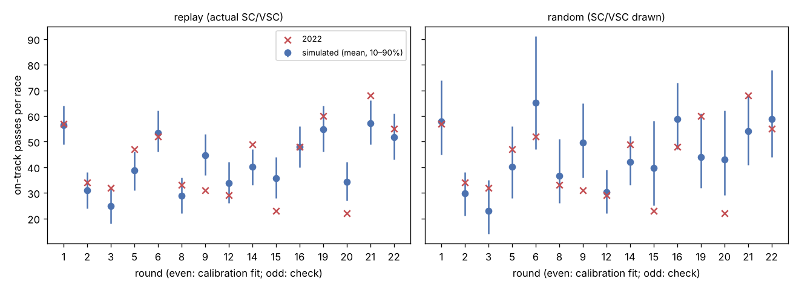
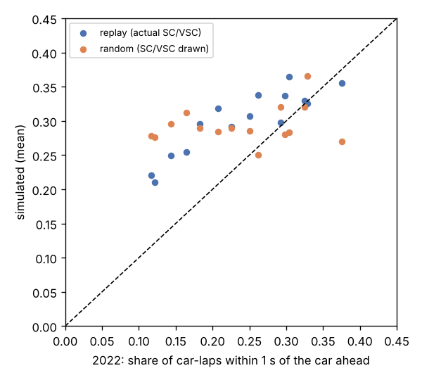
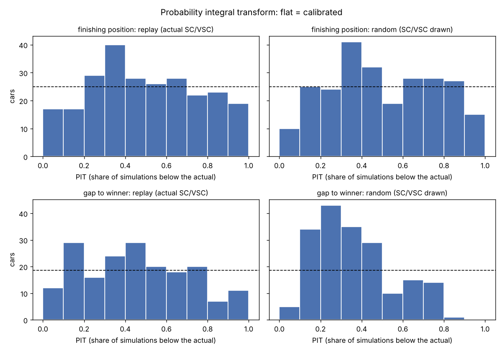
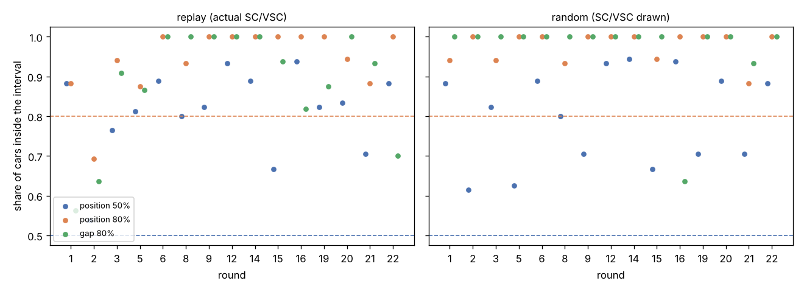
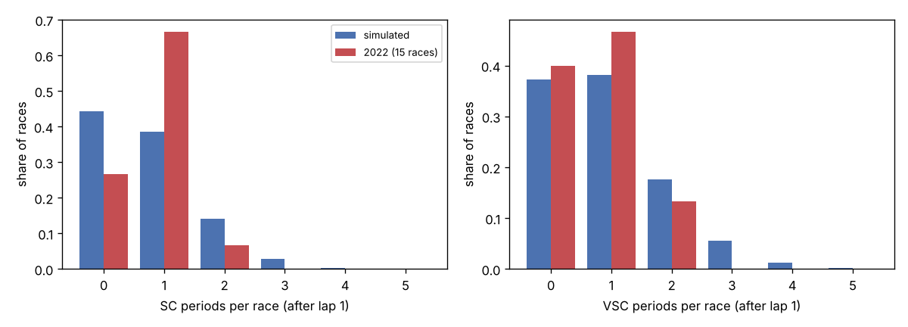

# Validation (Phase 5)

Status: **done.**
- Part A: passing diagnosis and calibration, SC queue and VSC fixes,
  backtests.
- Part B: Phase 6 dress rehearsal.
- Part C: the rehearsal with practice long runs and leakage-free
  parameters.

Code:
`src/f1strat/backtest.py`, `src/f1strat/rehearsal.py`. Rebuild everything with:

```
uv run python -m f1strat.race_events          # SC/VSC rates, pass model (keeps the calibration)
uv run python -m f1strat.backtest calibrate   # SC closing ratio, pass shift -> sim_params.json
uv run python -m f1strat.backtest run         # backtests, tables and plots
uv run python -m f1strat.backtest widening    # replay with widening 1.0 (sensitivity)
uv run python -m f1strat.rehearsal spain                 # Part B (refits the model)
uv run python -m f1strat.rehearsal canada
uv run python -m f1strat.rehearsal spain --cutoff-data   # Part C (practice, leakage-free)
uv run python -m f1strat.rehearsal canada --cutoff-data
```

Tables: `reports/figures/backtest_*.csv`. Plots: `reports/figures/backtest_*.png`.

## What the backtests test

**The lap model is the full posterior.** These backtests use the committed
thinned full fit (`models/deg_full_2022_thin.nc`), which includes each race's
own laps. That is deliberate:
- lap-time accuracy was already tested out of sample in Phase 3 (`last_stint`,
  `long_tyre`; `docs/model.md`);
- these backtests test the **simulator layers** on top of it: traffic,
  passing, SC/VSC, pit losses and how wide the intervals are.

Every stint effect is **drawn**, not taken from the fit, as it would be in a
case study. The race-level terms (base pace, driver offsets, tyre terms) come
from the fit, so these backtests are optimistic about pace. Phase 6 cutoff
refits remove that optimism.

**Races:** the 15 dry 2022 races outside the case studies (Monaco, Britain,
Hungary) and Austria (missing compounds; ROADMAP Decisions log): Bahrain,
Saudi Arabia, Australia, Miami, Spain, Azerbaijan, Canada, France, Belgium,
Netherlands, Italy, United States, Mexico, São Paulo, Abu Dhabi.

**Setup** (`run_backtest`), 1,000 simulations per race and mode:
- **Start:** the actual state at the end of lap 1. The simulator does not
  model lap 1 (`RaceState` starts at lap ≥ 1), so the grid and the first lap
  are taken as they happened, including the starting tyres.
- **Plans:** every car makes its actual stops on its actual laps with its
  actual compounds and set ages (`actual_plan`).
- **Retirements:** a car leaves at its actual last completed lap. Retired
  cars are left out of every metric; the metrics rank the finishers only.
  - A car finished if its last lap ended at or after the winner's (so lapped
    cars count as finishers).
  - A car that stops on track gets a session time but no lap time or position
    for its unfinished lap (e.g. Pérez in Bahrain); that lap is dropped.
- **Two modes:**
  - **replay:** the actual SC/VSC laps are forced in every simulation (red
    flag laps count as SC). Tests pace, traffic and positions.
  - **random:** SC/VSC periods are drawn at the 2022 rates. Tests the SC/VSC
    layer as well. Races with a late SC restart draw `final_race` from its
    prior (Phase 4 rule).
- **Not modelled:** time penalties (finishing order is the order on the
  road), blue flags, damage.

## Metrics

The same counters run on the actual race and on every simulation:
- **On-track pass:** one car is ahead of another at the end of lap `L − 1`
  and behind it at the end of lap `L`. Only green laps after lap 1 count, with
  neither car on an in or out lap and both still running.
  - The order is by race time at the end of each lap number, so lapping a
    backmarker is never a pass.
- **Close following:** the share of car-laps (green, after lap 1, not an
  in/out lap, not the leader) that end within 1 s of the car directly ahead.
- **Finishing position:**
  - share of actual positions inside the simulated central 50% and 80%
    intervals;
  - the PIT (probability integral transform): the share of simulations below
    the actual value, randomised on ties because positions are integers;
  - Spearman rank correlation between the actual order and the mean
    simulated position.
  - On integer positions an inclusive quantile interval covers more than its
    nominal level (a car simulated in P1 or P2 every time has a 50% interval
    of [1, 2]). So the PIT-based coverage (share of PITs in [0.25, 0.75] and
    [0.1, 0.9]) is the fair test.
- **Gap to the winner:** lead-lap finishers other than the winner; PIT
  histogram and interval coverage (continuous, so no tie issue).
- **SC/VSC counts** per race (random mode), against 2022.

## 1. Passing diagnosis

Phase 4 reported about 89 simulated passes per race against 31 in 2022 (about
2.5×). Before changing anything, two candidate causes were checked.

**(a) Lapping and blue flags: explains none of the gap.**
- The 2022 pass events (`race_events.pass_events`) pair a car with the car
  one position ahead *on the same lap number*. A leader lapping a backmarker
  is never such a pair, so lapping is not in the 2022 data.
- The simulator orders cars by race time and has no lapping, so it never
  counts lapping either.
- The backtest counter compares cars on the same lap number too, so lapping
  is excluded on both sides.

**(b) Close following: the simulator does too much of it, but this is not
what made passes look high.**
- Replaying the 15 races with actual plans and actual SC/VSC (Phase 4
  passing), simulated cars spend 1.5× as many car-laps within 1 s of the car
  ahead as in 2022 (even rounds 0.34 vs 0.22; odd 0.39 vs 0.27).
- Yet with the same counter on both sides, simulated passes were close to
  2022: 316 vs 322 over the even rounds and 294 vs 318 over the odd rounds,
  2–8% low.

**What made passes look too high: the two sides of the comparison measured
different things.**

| Effect | Spain example |
|---|---|
| The simulator's internal counter counts every successful pass coin-flip, including cars that pass and are passed back. Net position swaps are fewer. | 100 coin-flip passes vs 80 net swaps (actual plans, drawn SC/VSC) |
| The 2022 figure (31 per race) counted only the fitted events: pairs that started a lap within 1 s, with no pit on either lap. Real on-track swaps are 42.7 per race over these 15 races. 26% of real swaps started more than 1 s behind (a car with a problem), and 24% were not between adjacent cars. | 35 fitted events vs 52 swaps in the real race |
| The demo's rivals ran optimiser plans, and its SC/VSC were drawn. Drawn SCs bunch the field and add passes (see the random-mode results below). | 80 swaps with drawn SC/VSC vs 51 replayed (Spain had none) |

**Answer.** Most of the 2.5× was a counting mismatch, not too much passing.
Close following is a real excess. Held cars sit at exactly 0.68 s behind the
car ahead every lap they are held, so they stay "close". In 2022 the gap of a
car that did not pass ranged from 0.26 to 1.45 s (5th–95th percentile), and
17% fell back beyond 1 s.

## 2. Passing calibration

**Fewest parameters:** one free parameter, plus one change with no free
parameter.
1. **Held gap drawn from 2022 (no free parameter).** A held car's gap is
   drawn from the 2022 gaps of cars within 1 s that did not pass (41
   quantiles stored in `sim_params.json`, `passing.held_gaps`), instead of the
   fixed median 0.68 s.
   - The draw reuses the pass coin-flip's leftover uniform, which is uniform
     given that the car was held, so no random numbers are added and common
     random numbers still hold.
2. **One shift on every circuit's pass intercept** (`passing.shift`), fitted
   by bisection so that replayed **even-round** races have the actual number
   of on-track passes. Result: **+0.986**. The shift is fitted after the SC
   queue fix below, because SC bunching changes how many passes follow a
   restart. It was +0.674 with the Phase 4 SC queue.
   - Pooled curve: equal-pace pass probability rises from 6% to 15% per lap;
     an attacker 1 s/lap faster passes with 75% instead of 46%.
   - What it absorbs: real passes the simulator has no mechanism for, such as
     a car with a problem lap passed from more than 1 s back, or a two-car
     pass.

Checked on the **odd rounds** (not used in the fit). The first three rows use
the Phase 4 SC queue:

| Passing | Even rounds (fit): passes, sim / 2022 | close share, sim / 2022 | Odd rounds (check): passes | close share |
|---|---|---|---|---|
| Phase 4 (gap fixed at 0.68 s, no shift) | 316 / 322 | 0.342 / 0.216 | 294 / 318 | 0.393 / 0.267 |
| Dirty-air loss 0.21 s/lap only (the Phase 3 `dirty_air_penalty`) | 292 / 322 | 0.328 / 0.216 | 269 / 318 | 0.376 / 0.267 |
| Held gaps drawn, no shift | 278 / 322 | 0.288 / 0.216 | 252 / 318 | 0.332 / 0.267 |
| **Held gaps drawn + SC closing + shift 0.986 (final)** | **322 / 322** | **0.266 / 0.216** | **311 / 318** | **0.308 / 0.267** |

- **Passes:** on the odd rounds the calibrated simulator is 2% low
  (311 vs 318).
- **Close following (limitation):** still **1.15–1.25× 2022** (0.266 vs
  0.216 even, 0.308 vs 0.267 odd; 0.285 vs 0.240 over all 15 races).
  - No pass setting fixes it. With the slope scaled ×0.5 to ×3 and the shift
    refitted each time, the close share stayed between 0.31 and 0.34. So the
    rest is in how cars follow, not in how they pass.
  - **Effect:** simulated cars spend slightly too many laps in traffic, so the
    time lost behind slower cars (and the value of an undercut that clears
    traffic) may be slightly overstated.
- **Dirty air:** applying the Phase 3 `dirty_air_penalty` (0.21 s/lap) to
  following cars barely helped, because a held car is pinned to the car ahead
  anyway. It is left out (`dirty_air_s = 0`; the option stays in the code).





## SC queue: gradual closing (approved fix)

**Problem (found in the first backtest run).** In Phase 4, the first SC lap
compressed the whole field to 0.8 s gaps.
- **Cause:** the leader lapped at 1.49× and everyone behind at 1.09× their own
  pace, which closes about 38 s per lap.
- **Effect:** a car that pitted under the SC dropped behind cars it really
  stayed ahead of. That is Pérez in Saudi Arabia (below), and the Silverstone
  case study turns on exactly this.

**Fix.** Gaps are kept on the first SC lap. On each later SC lap, every gap to
the car ahead is multiplied by a fixed ratio, down to `sc_gap_s` (0.8 s):
`neutral.sc_close_ratio`.
- **Fitted on even rounds, checked on odd rounds**
  (`backtest.sc_gap_observations`). For each SC period, each car and the car
  directly ahead of it before the SC are followed while neither pits; most
  cars pit under SC, so requiring the pair to stay adjacent would leave too
  few pairs.
- **Result:** **0.58 per lap**, fitted on the squared error in seconds.
  - A log-error fit gives 0.64. That fit is dominated by the many sub-2 s
    pairs, and it closes 15–25 s gaps far too slowly.
  - Seconds is what matters here: pit-under-SC losses and final margins come
    from the large gaps.
- **Thin fit data.** The even backtest rounds have only 3 SC periods (Saudi
  Arabia, Belgium, Italy); the odd rounds have 8.

Median gap (s) at the end of SC lap `k`, odd rounds (check;
`reports/figures/sc_closing.csv`):

| SC lap `k` | 1 | 2 | 3 | 4 | 5 | 6 |
|---|---|---|---|---|---|---|
| gap before > 5 s (median 12.8 s), observed | 12.6 | 7.0 | 4.3 | 1.9 | 1.5 | 0.7 |
| simulated, ratio 0.58 | 12.8 | 7.4 | 4.3 | 2.5 | 1.9 | 1.0 |
| simulated, Phase 4 | 0.8 | 0.8 | 0.8 | 0.8 | 0.8 | 0.8 |
| gap before ≤ 5 s (median 1.1 s), observed | 1.7 | 1.6 | 1.6 | 0.6 | 0.9 | 0.3 |
| simulated, ratio 0.58 | 1.1 | 0.8 | 0.8 | 0.8 | 0.8 | 0.8 |

- Large gaps now close at the real rate.
- **Small gaps** (limitation): in 2022 they open up a little on the first
  three SC laps (cars weaving and warming tyres); the simulator holds them at
  0.8 s from lap 2.

**Saudi Arabia, replay, before and after:**

| | Phase 4 SC queue: mean position (80% interval) | Gradual closing | Actual |
|---|---|---|---|
| Pérez (pitted lap 15; SC lap 16) | 1.35 (1–2) | **2.25 (1–4)** | 4 |
| Hamilton (hard start, stayed out, pitted lap 40) | 6.43 (5–8) | 6.90 (6–8) | 10 |
| Verstappen | 3.00 (2–4) | 2.61 (1–4) | 1 |
| Saudi Arabia: positions inside 80% / 50% | 0.69 / 0.54 | **0.85 / 0.62** | |

- **Pérez:** now inside his 80% interval. Leclerc, Verstappen and Sainz
  stopping under the SC no longer drop behind him.
- **Hamilton:** not explained by the SC queue. A likely candidate is the
  Phase 3 watch item: Saudi's hard degradation is about zero, so his 40-lap
  first stint on hards (full fuel) loses no time to wear in the simulator.
  The model has no fuel × compound interaction to correct it.

## VSC counting (fixed)

`fit_neutralisations` used the race table's period numbering, where a VSC that
turns into an SC is a VSC period followed by an SC period. So it counted both.
- **2022:** 5 of the 18 VSCs did this (Bahrain, Saudi Arabia, Australia,
  Miami, São Paulo). Austin's safety car was also split into two back-to-back
  SC periods.
- **Fix** (`race_events.neutral_runs`): a run of neutralised laps with no
  green lap in between is one period. It is an SC if any lap of it is under
  SC.
- **Result:** 13 SCs and 13 VSCs over 961 green laps, both 1.35% per lap
  (were 14 and 18). Simulated VSCs per race (random mode) fall from 0.96 to
  0.69, against 0.67 in 2022 counted the same way. The backtests count actual
  and simulated periods with the same rule (`neutral_counts`).

## 3–4. Backtest results

### Overall (249 finishers, 186 lead-lap gaps, 15 races)

Final settings: held gaps drawn, pass shift +0.986, SC closing 0.58,
corrected VSC rate, final-stint widening ×1.188 (the Phase 4 default). The
last column repeats replay with widening 1.0 (next section).

| Metric | Target | replay | random | replay, widening 1.0 |
|---|---|---|---|---|
| Positions inside 50% interval (inclusive) | ≥ 0.50 | 0.82 | 0.81 | 0.80 |
| Positions inside 80% interval (inclusive) | ≥ 0.80 | 0.96 | 0.97 | 0.95 |
| PIT in [0.25, 0.75] (fair 50% coverage) | 0.50 | 0.60 | 0.59 | **0.57** |
| PIT in [0.1, 0.9] (fair 80% coverage) | 0.80 | 0.87 | 0.87 | **0.85** |
| Spearman, mean over races | | 0.962 | 0.945 | 0.961 |
| Mean abs. error, actual vs mean simulated position | | 0.97 | 1.16 | 0.96 |
| **Naive baseline** (order after lap 1): Spearman / mean abs. error | | 0.763 / 2.33 | | |
| Gap to winner inside 50% interval | 0.50 | 0.55 | 0.52 | **0.54** |
| Gap to winner inside 80% interval | 0.80 | 0.84 | 0.89 | **0.82** |
| On-track passes per race, 2022 / sim | | 42.7 / 42.2 | 42.7 / 44.9 | 42.7 / 41.5 |
| Close share, 2022 / sim | | 0.24 / 0.29 | 0.24 / 0.28 | 0.24 / 0.29 |
| SC periods per race, 2022 / sim | | | 0.80 / 0.72 | |
| VSC periods per race, 2022 / sim | | | 0.67 / 0.69 | |

**Naive baseline.** Taking the order after lap 1 as the finishing order gives
a mean Spearman of 0.763 and a mean position error of 2.33 places. The
simulator, from the same starting point with the actual stops, gives 0.962
and 0.97 places. In every race it beats the baseline on both (per-race table
below), so the simulator adds a lot beyond "the order after lap 1 holds".

### Final-stint widening: ×1.188 or 1.0

Positions were over-covered (fair 80% coverage 0.87). The Phase 3 widening
factor (×1.188 on the drawn final-stint spread) was a candidate cause, so the
replay was rerun with widening 1.0:

| Replay | Positions, fair 50% / 80% | Gaps, 50% / 80% | Spearman | MAE |
|---|---|---|---|---|
| widening ×1.188 | 0.60 / 0.87 | 0.55 / 0.84 | 0.962 | 0.97 |
| widening 1.0 | 0.57 / 0.85 | 0.54 / 0.82 | 0.961 | 0.96 |

- **1.0 is better calibrated on all four coverage numbers.** Point accuracy
  is unchanged.
- **Phase 6 uses widening 1.0** and reports ×1.188 as a sensitivity check.
- **The widening is not the main cause.** Positions are still over-covered
  with 1.0 (0.85 vs 0.80). Intervals stay slightly wide, so verdicts are
  conservative.
- Phase 3's ×1.188 came from lap-time intervals on held-out final stints.
  Here the drawn final-stint shift is one of several sources of spread in
  race positions (pit-loss draws, SC/VSC, passing coin-flips), so the race
  level needs less of it.



**Reading the PIT histograms:**
- **Positions:** close to flat in both modes, with a mild hump in the middle
  and thin tails. Intervals are slightly too wide.
- **Gaps, replay:** skewed toward low PITs (median PIT 0.37). Real gaps to the
  winner are smaller than the simulated median for most cars; the median
  simulated gap is 1.11× the actual one.
  - This appeared with the SC fix: the Phase 4 queue over-bunched the field
    at every SC, and that happened to offset it.
  - Likely causes: gaps under ~5 s that do not quite close, and close
    following (a car held at a drawn gap is never closer than the real one).
  - Coverage is still near nominal (0.55 / 0.84).
- **Gaps, random:** more skewed (median PIT 0.28; median simulated gap 1.76×
  actual). Drawn SC/VSC timing spreads the field more than the 2022 races'
  actual SCs did. In 12 of these 15 races there was an SC or VSC, and
  several came late, which compressed the final gaps (Italy finished under
  SC: real gaps of a few seconds, 80% coverage 0.18).

### Per race: replay (actual SC/VSC)

Spearman and MAE (mean absolute position error) with the naive baseline (order
after lap 1) in brackets.

| Round | Race | Finishers | Pos in 50% | Pos in 80% | Spearman (naive) | MAE (naive) | Gap in 50% | Gap in 80% | Passes 2022 | Passes sim (10–90%) | Close 2022 | Close sim |
|--:|:--|--:|--:|--:|:--|:--|--:|--:|--:|:--|--:|--:|
| 1 | Bahrain | 17 | 0.82 | 0.88 | 0.95 (0.83) | 0.85 (2.12) | 0.12 | 0.38 | 57 | 57 (49–64) | 0.18 | 0.28 |
| 2 | Saudi Arabia | 13 | 0.62 | 0.85 | 0.92 (0.90) | 1.13 (1.38) | 0.36 | 0.55 | 34 | 31 (24–38) | 0.26 | 0.30 |
| 3 | Australia | 17 | 0.82 | 1.00 | 0.93 (0.78) | 1.10 (2.12) | 0.45 | 1.00 | 32 | 25 (18–32) | 0.38 | 0.33 |
| 5 | Miami | 16 | 0.81 | 0.88 | 0.98 (0.70) | 0.80 (2.75) | 0.73 | 0.87 | 47 | 39 (31–46) | 0.25 | 0.30 |
| 6 | Spain | 18 | 0.89 | 1.00 | 0.99 (0.69) | 0.68 (2.44) | 0.57 | 1.00 | 52 | 53 (46–62) | 0.12 | 0.21 |
| 8 | Azerbaijan | 15 | 0.80 | 0.93 | 0.96 (0.91) | 0.75 (1.20) | 0.44 | 1.00 | 33 | 29 (22–36) | 0.14 | 0.24 |
| 9 | Canada | 17 | 0.82 | 1.00 | 0.97 (0.56) | 0.84 (3.06) | 0.88 | 0.94 | 31 | 45 (37–53) | 0.32 | 0.32 |
| 12 | France | 15 | 0.93 | 1.00 | 0.98 (0.77) | 0.77 (1.73) | 0.64 | 0.93 | 29 | 34 (26–42) | 0.30 | 0.29 |
| 14 | Belgium | 18 | 0.83 | 1.00 | 0.98 (0.60) | 0.91 (3.78) | 0.64 | 1.00 | 49 | 40 (33–47) | 0.29 | 0.29 |
| 15 | Netherlands | 18 | 0.72 | 1.00 | 0.96 (0.88) | 0.97 (1.89) | 0.31 | 0.62 | 23 | 36 (28–44) | 0.23 | 0.28 |
| 16 | Italy | 16 | 0.88 | 1.00 | 0.97 (0.51) | 1.03 (3.62) | 0.73 | 0.91 | 48 | 48 (40–56) | 0.33 | 0.32 |
| 19 | United States | 17 | 0.88 | 0.94 | 0.95 (0.72) | 1.44 (3.06) | 0.56 | 0.94 | 60 | 55 (46–64) | 0.30 | 0.35 |
| 20 | Mexico | 18 | 0.83 | 1.00 | 0.97 (0.92) | 1.00 (1.33) | 1.00 | 1.00 | 22 | 34 (27–42) | 0.12 | 0.22 |
| 21 | São Paulo | 17 | 0.65 | 0.88 | 0.94 (0.76) | 1.47 (2.47) | 0.80 | 0.93 | 68 | 57 (49–66) | 0.21 | 0.31 |
| 22 | Abu Dhabi | 17 | 0.88 | 1.00 | 0.98 (0.91) | 0.84 (1.65) | 0.20 | 0.80 | 55 | 52 (43–61) | 0.16 | 0.25 |

### Per race: random (SC/VSC drawn)

| Round | Race | Pos in 50% | Pos in 80% | Spearman | Gap in 80% | Passes 2022 | Passes sim (10–90%) | SC 2022 / sim | VSC 2022 / sim |
|--:|:--|--:|--:|--:|--:|--:|:--|:--|:--|
| 1 | Bahrain | 0.94 | 0.94 | 0.96 | 0.62 | 57 | 58 (45–74) | 1 / 0.71 | 0 / 0.67 |
| 2 | Saudi Arabia | 0.62 | 0.92 | 0.88 | 1.00 | 34 | 30 (21–38) | 1 / 0.59 | 1 / 0.56 |
| 3 | Australia | 0.82 | 0.94 | 0.92 | 1.00 | 32 | 23 (14–35) | 2 / 0.69 | 1 / 0.67 |
| 5 | Miami | 0.62 | 1.00 | 0.94 | 0.93 | 47 | 40 (28–56) | 1 / 0.71 | 0 / 0.67 |
| 6 | Spain | 0.89 | 1.00 | 0.98 | 1.00 | 52 | 65 (47–91) | 0 / 0.80 | 0 / 0.81 |
| 8 | Azerbaijan | 0.80 | 0.93 | 0.91 | 1.00 | 33 | 37 (26–51) | 0 / 0.60 | 2 / 0.60 |
| 9 | Canada | 0.71 | 1.00 | 0.94 | 0.94 | 31 | 50 (36–65) | 1 / 0.86 | 2 / 0.85 |
| 12 | France | 0.93 | 1.00 | 0.99 | 1.00 | 29 | 30 (22–39) | 1 / 0.69 | 1 / 0.63 |
| 14 | Belgium | 0.94 | 1.00 | 0.97 | 1.00 | 49 | 42 (33–52) | 1 / 0.54 | 0 / 0.49 |
| 15 | Netherlands | 0.61 | 0.94 | 0.95 | 0.81 | 23 | 40 (25–58) | 1 / 0.88 | 1 / 0.87 |
| 16 | Italy | 0.94 | 1.00 | 0.97 | 0.36 | 48 | 59 (47–73) | 1 / 0.69 | 1 / 0.63 |
| 19 | United States | 0.65 | 1.00 | 0.92 | 1.00 | 60 | 44 (32–61) | 1 / 0.66 | 0 / 0.67 |
| 20 | Mexico | 0.89 | 1.00 | 0.95 | 1.00 | 22 | 43 (29–62) | 0 / 0.85 | 1 / 0.82 |
| 21 | São Paulo | 0.82 | 0.88 | 0.92 | 0.87 | 68 | 54 (41–68) | 1 / 0.79 | 0 / 0.77 |
| 22 | Abu Dhabi | 0.88 | 1.00 | 0.96 | 1.00 | 55 | 59 (44–78) | 0 / 0.69 | 0 / 0.67 |





**SC/VSC rates (random mode).**
- SCs per race: 0.72 simulated vs 0.80 in 2022.
- VSCs per race: 0.69 vs 0.67, after the counting fix (0.96 before).
- **Spread:** simulated counts are more spread out (more races with none,
  more with two or more) than these 15 races, where most had exactly one SC.
  With 15 races this is not clear evidence against the pooled rates.
- **Limitation:** the rates are pooled over the season and constant per lap
  (no circuit effect, no late-race clustering).

**Passes in random mode** have wide intervals (Spain 47–91): a drawn SC
bunches the field, and passes follow at the restart.

## 5. Australia, Saudi Arabia, Miami, São Paulo (Phase 3 watch items)

- **Australia, Miami, São Paulo backtest fine:** 80% position coverage of
  0.94, 0.88 and 0.88 in replay; Spearman 0.92–0.97. The watch items (flat or
  negative hard degradation in Australia and Miami; hard degrading faster than
  soft in São Paulo) do not show up as position misses.
- **Saudi Arabia was the weakest race:** replay 80% coverage 0.69 with the
  Phase 4 SC queue. Watch item first:
  - Saudi's field hard degradation is about zero (−0.001 s/lap, 80% interval
    −0.010 to +0.008), not clearly negative.
  - The biggest miss, Pérez, was the SC queue (fixed above; Saudi's coverage
    is now 0.85).
  - Hamilton's remaining miss (simulated 6.9th, finished 10th) fits the watch
    item: a 40-lap first stint on hards that loses no time to wear.

## Part B: Phase 6 dress rehearsal

**Goal:** run the whole case-study pipeline on two non-case races, cut at
mid-race with no future information, and compare its picks with what
happened. Code: `src/f1strat/rehearsal.py`. Reports:
`reports/figures/rehearsal_<race>[_cutoff].md`.

**Pipeline** (`python -m f1strat.rehearsal <race> [--cutoff-data]`):
1. **Leakage-free data:** `deg_model.cutoff_inputs` keeps earlier rounds plus
   the decision race up to the cutoff lap.
   - Cleaning is recomputed from those laps only: the 107% outlier median,
     and the pit stops whose losses the simulator resamples.
   - No stint of the decision race is labelled final.
   - (Phase 6 open issue, now resolved. A test changes every later lap and
     checks that nothing moves.)
2. **Refit:** `fit(laps, cutoff=...)` with the Phase 3 sampler settings.
3. **Race state** at the cutoff lap, with each car's remaining sets from its
   reconstructed practice/qualifying inventory.
4. **Search for one front-runner** (Verstappen in both). Rivals' plans come
   from their own single-car searches on the same fit (top 3, weighted),
   never their actual later stops. SC/VSC are drawn. Widening 1.0, with
   ×1.188 as a sensitivity check.
5. **Compare** with the race:
   - the focal pick vs the actual plan;
   - every finisher's simulated position under the focal's actual plan,
     re-ranked among the cars that finished (later retirements are
     unknowable at the cutoff);
   - rivals' option plans vs their actual stops.

**Races:**
- **Spain**, cut after lap 33 of 66.
- **Canada**, cut after lap 35 of 70: a strategy race (Verstappen vs Sainz,
  two VSCs and a late SC), round 9, so its refit is manageable.

**Two data modes:**
- **Part B (as first specified):** race laps only; passing and SC/VSC
  parameters from the whole season.
- **Part C (added after Part B):** the decision race's practice long runs in
  the fit (`docs/model.md`); passing and SC/VSC parameters from earlier
  rounds only, and the circuit's pass difficulty from its previous running.
  Fits must have 0 divergences.

### Results

| | Spain B | Spain C | Canada B | Canada C |
|---|---|---|---|---|
| Fit | 5 races, 13.5 min | 5 races + 239 practice laps, 16.2 min | 7 races, 24.9 min | 7 races + 311 practice laps, 74.4 min |
| R-hat max / ESS min / divergences | 1.005 / 954 / **3** | 1.006 / 1,385 / **0** | 1.002 / 2,428 / 0 | 1.003 / 3,316 / **0** |
| Spain hard degradation (s/lap; full fit 0.123) | **0.038** | **0.116** | | |
| Focal pick (best mean position) | S → 39 H(new) | S → 46 M(new) | H → 40 H(new) | H → 40 S(new) |
| Pick: mean position / P(win) | 1.87 / 0.46 | 1.46 / 0.68 | 1.50 / 0.60 | 1.28 / 0.78 |
| Actual plan | S → 44 M(new) | same | H → 43 H(new) | same |
| Actual plan: mean position / P(win) | 2.95 / 0.38 | 1.50 / 0.65 | 1.62 / 0.59 | 1.85 / 0.44 |
| Actual plan: rank among candidates; places behind pick | 7th; 1.08 | 3rd; 0.05 | 4th; 0.12 | 7th; **0.57** |
| Verstappen actually finished | 1 | 1 | 1 | 1 |
| Finishers inside simulated 10–90% | 94% | 94% | 94% | 82% |
| Rivals whose top option fits a hard | 16 of 17 (13 new) | 1 of 17 (used) | — | — |

**Spain, Part B: the search sent everyone onto hards.** By lap 33, Spain had
2 clean hard laps.
- Spain's `deg[hard]` fell back to the season pool: 0.038 s/lap, against
  0.123 s/lap once the whole race is in.
- The search picked a new hard for Verstappen (actual medium plan 1.1 places
  worse). For 16 of 17 rivals the top option also fitted a hard (13 new); in
  the race almost nobody used hards.
- This is exactly the Hungary case-study situation (Leclerc onto hards).

**Spain, Part C: practice fixes it.**
- With the FP1–FP3 long runs (only one 6-lap hard run, but 20 runs on softs
  and mediums anchor the fuel slope), Spain's hard degradation is 0.116
  s/lap. The hard is now slower and wears like the others.
- Verstappen's pick becomes soft → new medium at lap 46. His actual soft →
  new medium at lap 44 is third, 0.05 places behind, well inside the noise.
- Only Vettel's top option fits a hard (a used one). Hamilton's top option
  equals his actual plan; Russell's and Pérez's top options are their actual
  compounds with one stop fewer.
- **Race times** are about 100 s longer than in Part B. Verstappen's own
  laps 34–66 are the same (2,874 s vs 2,873 s; actual 2,885 s). The extra
  time is SC laps: the SC rate known after rounds 1–5 is 2.7% per lap,
  double the season rate.

**Canada:** the cutoff fit gets Verstappen's strategy right in Part B.
- The pick is one stop onto new hards at lap 40, against his actual lap 43
  (0.12 places, inside the noise).
- Rivals' own searches chose one stop, like their actual plans, but mostly
  4–13 laps earlier than they stopped.
- Only 3 green-flag stops were known at lap 35: most cars had stopped under
  the two VSCs. Pit losses are resampled from those 3, a thin basis.

**Canada, Part C: practice moves the pick onto softs, and the race cannot
check it.**
- The pick becomes new softs at lap 40 for the last 30 laps, 0.57 places
  better than Verstappen's actual new hards at lap 43 (P(win) 0.78 vs 0.44).
- No car ran a soft in the Canada race, so even the full fit's soft
  degradation there (0.104 s/lap) is just the season pool.
- Practice had 4 soft runs. The 3 FP2 runs rise about 0.04 s/lap within the
  run, raw; with the fuel slope that gives the fit's 0.078 s/lap (Part B,
  pooled: 0.111).
- The recommended 30-lap soft stint extrapolates runs of about 12 laps
  linearly. Every team avoided the soft, which suggests wear (graining, a
  cliff) that a linear model on short runs cannot see: the Phase 3
  limitation "linear degradation on long stints".
- **Canada's previous running is unavailable.** 2020 and 2021 were
  cancelled, and 2019 timing data cannot be downloaded without an F1
  account, so Canada uses the pooled pass intercept from rounds 1–8
  (−2.49). Its own 2022 race gave −3.61. Passing is therefore easier in
  Part C, which helps any plan that loses track position and has to pass
  back.
- Field check: 82% of finishers inside their simulated 10–90% range;
  Magnussen, Albon and Latifi miss by one place.

**Leakage-free parameters (Part C)**
(`reports/figures/rehearsal_<race>_cutoff_params.json`):

| | Spain (rounds 1–5) | Canada (rounds 1–8) | Season (`sim_params.json`) |
|---|---|---|---|
| Circuit pass intercept (previous running) | −3.21 (2021) | −2.49 (pooled: 2019 not downloadable) | Spain −2.64, Canada −3.61 (own 2022 race) |
| Pooled intercept / slope | −2.45 / 2.33 | −2.49 / 2.28 | −2.75 / 2.86 |
| Pass shift (replay of earlier rounds) | +1.35 | +1.28 | +0.99 |
| SC closing ratio | 0.575 | 0.575 | 0.58 |
| SC / VSC start per green lap | 2.7% / 1.1% | 1.7% / 1.3% | 1.35% / 1.35% |

**Divergence rule.** Fits used for results must have 0 divergences.
`rehearsal.clean_fit` reruns a fit with a new seed, then with target
acceptance 0.99, until it has none.
- Both Part C fits are divergence-free.
- Spain's Part B fit had 3 divergences. Part B is superseded by Part C and
  kept only to show the hard-tyre problem.

**Does the Spain search still push everyone onto hards?** No. With practice
long runs, Spain's hard degradation is 0.116 s/lap (full fit 0.123). The
search picks Verstappen's actual compound (medium) within two laps of his
actual stop, and only one rival's top option fits a hard.

**What the rehearsals say for Phase 6:**
- **The pipeline runs end to end without future information.** With the
  Part C data, Spain puts the team's actual call 0.05 places from the best
  plan and 94% of finishers inside their simulated range.
- **Practice data is necessary but not sufficient for a compound not yet
  raced.**
  - It fixed Spain's hard, a compound the race later showed.
  - In Canada it made a 30-lap soft stint look best, on the strength of
    ~12-lap runs, where no team ran the soft.
  - For Hungary (Leclerc onto hards), Phase 6 must report how long the
    practice runs on the decision compound were, against the stint length
    the verdict relies on.
  - It must also show the verdict's sensitivity to that compound's
    degradation (e.g. the pooled value vs practice-informed).
- **Pit losses can rest on few stops at the cutoff** (Canada: 3). Phase 6
  should report how many stops back each pit-loss estimate.
- **Leakage-free parameters move results:**
  - Early-season SC rates are noisy (Spain: 2.7% per lap from 4 races).
  - A missing previous running changes pass difficulty (Canada: pooled −2.49
    vs its own −3.61).
  - The case studies' previous runnings are 2021 races. 2021 timing data
    downloads (Spain 2021 here, Monaco 2021 in Phase 2), but Phase 6 must
    confirm Hungary and Britain 2021 load.
  - Verdicts should show sensitivity to the SC rate.

## Is calibration good enough for the case studies?

- **Positions:** yes, slightly conservative. With widening 1.0 (the Phase 6
  setting), fair 50% / 80% coverage is 0.57 / 0.85 and Spearman 0.96, against
  0.76 for the naive baseline. Intervals are a little wide, so a verdict that
  a call was outside the range of good options will not come from intervals
  that are too narrow.
- **Gaps:** near-nominal coverage in replay (0.54 / 0.82 with widening 1.0),
  but simulated gaps run about 10% large. Random mode is too wide, so
  case-study probabilities that depend on SC luck are conservative.
- **Passing:** race-level pass counts match after calibration (odd-round
  check 2% low).
- **SC queue:** now closes at the 2022 rate for large gaps. Silverstone's
  verdict can use it, with the small-gap limitation below.

**Limitations to state in Phase 6:**
- **Close following** is 1.15–1.25× 2022 after calibration. Time lost in
  traffic, and the value of clearing it, may be slightly overstated.
- **Small gaps under SC** close to 0.8 s from the second SC lap. In 2022 they
  stayed around 1.6 s for three laps.
- **SC closing ratio** is fitted on only 3 SC periods (even rounds). The
  odd-round check is good for large gaps.
- **SC/VSC hazards** are pooled and constant per lap; random-mode gaps are
  too wide.
- **Pace is in-sample.** These backtests use the full posterior, so they are
  optimistic about pace. Phase 6 cutoff refits are the honest test (Part B).
- **Not modelled:** lap 1 (taken as it happened), time penalties, blue flags,
  damage.
- **Passing and SC/VSC parameters in these backtests use the whole 2022
  season.** For cutoff fits, Part C estimates them from earlier rounds only
  (see the Part B section).
